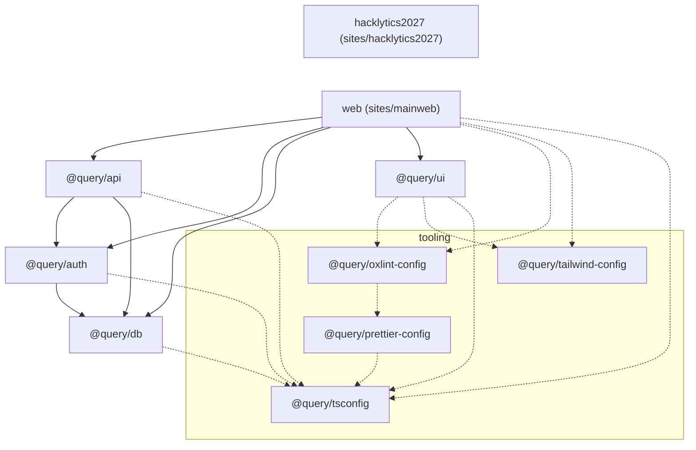
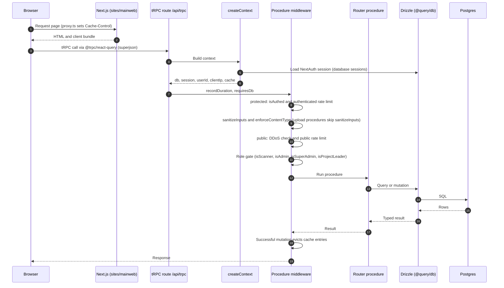

# Architecture

**query** is a pnpm + Turborepo monorepo. Two Next.js sites share four internal packages. Club operations and hackathon operations share one Postgres database but are modeled as separate domains.

```
┌─────────────────────────────────────────────────────────────┐
│                     sites/hacklytics2027                    │
│              Static marketing site (Firebase Hosting)       │
│         Interest CTA → portal /login?callbackUrl=/hacklytics│
└────────────────────────────┬────────────────────────────────┘
                             │ absolute URL
┌────────────────────────────▼────────────────────────────────┐
│                       sites/mainweb  (web)                  │
│  Public pages          Portal route group `(portal)`        │
│  / /team /events       /login /dashboard /admin /judge …    │
│                             │                               │
│                    /api/trpc  /api/auth  /api/webhooks      │
└──────────┬──────────────────┴───────────────┬───────────────┘
           │                                  │
    ┌──────▼──────┐                    ┌──────▼──────┐
    │ @query/api  │◄──── session ──────│ @query/auth │
    │  tRPC app   │                    │  NextAuth   │
    └──────┬──────┘                    └──────┬──────┘
           │                                  │
           └──────────────┬───────────────────┘
                          │
                   ┌──────▼──────┐
                   │  @query/db  │  Drizzle + pg.Pool → Neon / local Postgres
                   └─────────────┘
```

`@query/ui` is a small shared component library consumed by mainweb. It is not on the request path.

## Monorepo map

How the workspaces depend on each other. Solid lines are runtime dependencies, dotted lines are dev-time configs. `hacklytics2027` has no workspace dependencies.



## Two products, one database

The schema is split on purpose. Mixing them previously made membership vanish when a new hackathon edition was drafted.

### Club

Year-round DSGT operations. **Not** scoped to a hackathon row.

- Membership (`member`, `membership_history`) — one paid year per person, defined by start/end dates
- Club events and QR check-in (`event`, `event_check_in`)
- Bootcamp sessions are club events with `bootcamp_week` + `bootcamp_term`
- Bootcamp workshop material (`bootcamp_workshop`, one row per week) joins those events on `(term, week)`; the ZIPs are in Cloud Storage and downloads are gated on the workshop's own term — see [Bootcamp materials](./bootcamp-materials.md)
- Initiatives (`initiative`, `initiative_application`) led by `project_leader`
- Stripe payments and account linking

Club benefits (portal `/club`, bootcamp, initiatives) gate on a **paid, unexpired** membership. A `member` row that has lapsed is not treated as active.

### Hackathon

Edition-scoped event operations. Everything hangs off `hackathon`.

- Editions, interest list, registration, teams, project submission
- Weekend schedule (`hackathon_event`) and badge scans
- Judge roster (`judge`, `judge_assignment`): applications and approval
- Judging: room-based judging with Devpost import — `judging_*` tables (`judging.ts`). The older pool-dispatch tables (`judging_project`, `judge_vote`, `judge_queue`, `hackathon_result`) are retired and kept for past editions' results
- Points: `hackathon_event` points, staff adjustments and the point store (`points.ts`)
- Event check-in rules: nobody is checked into two events that run at the same time, or into two less than 30 minutes apart (meals are exempt). `recordEventAttendance` enforces this for pass scans, event codes and manual check-in
- Check-in rule-break flags: each refused attempt is recorded (`hackathon_check_in_flag`, `services/check-in-flags.ts`) and shown in judging on the hacker's team, in full to organisers and as a bare marker to judges. Organisers decide whether to pull the team from prizes (`judging_entry.prize_ineligible_at`). A flag outlives the events it names (deleting one clears its id and the organiser view shows "A deleted event"). Hackers never see flags, and they stay out of public and cached payloads
- Announcements and acceptance waves

Hackathon participation is **open to non-members**. Membership is not a registration requirement.

`resolveCurrentHackathonId` (in `@query/db`) is the single definition of “the current edition”: an in-progress event if one exists, otherwise the newest edition whose status is not `draft` or `announced`. Drafting next year must not retarget memberships, portal gates, or club check-in.

## Request path (mainweb)

1. Next.js App Router in `sites/mainweb`.
2. `proxy.ts` sets Cache-Control (private `no-store` on authenticated prefixes). It does not mint ETags.
3. Browser calls `/api/trpc/*` via `@trpc/react-query`. Superjson is the transformer.
4. `createContext` loads the NextAuth session (when `db` exists), attaches `userId`, client IP, and the in-process cache.
5. Procedures run through DB-required, sanitizer, content-type, rate-limit / DDoS, and (for mutations) cache invalidation middleware.
6. Role gates (`isAdmin`, `isScanner`, `isProjectLeader`, `isSuperAdmin`) live in `packages/api/src/middleware/procedures.ts`. There is no `adminProcedure` alias that skips a role check.

The same path as a sequence. Public procedures run the DDoS and public rate limit checks; protected ones check the session and the authenticated rate limit instead. Cache eviction only happens for successful mutations.



## Auth

NextAuth v5 (`next-auth@5` beta) with a **database session** strategy when `DATABASE_URL` is set, otherwise JWT.

Providers:

- Google (always registered; PKCE + state)
- GitHub (only if both client id and secret are set)
- Email 6-digit code via nodemailer (CSPRNG, 10-minute TTL, previous codes deleted)

On every successful sign-in, `linkPaidPaymentByVerifiedEmail` claims a paid-but-unlinked Stripe payment for that verified address and grants membership. Failures are swallowed so a membership glitch cannot block login.

## Payments

Stripe Checkout and Payment Intents both exist. Amounts are defined once in `@query/api` pricing:

| Product | Cents |
| --- | --- |
| Annual membership | `2500` ($25) |
| Bootcamp add-on (on top of membership) | `1000` ($10) |
| Max charge treated as membership | `10000` |

The webhook is `sites/mainweb/app/(portal)/api/webhooks/stripe/route.ts`. Linking can also happen from the portal (`stripe.linkAccount`, `stripe.attemptAutoLink`) and at sign-in.

## Caching

`packages/api/src/middleware/cache.ts` is an **in-memory TTL cache** per Node process (not Redis). Role lookups and portal context are cached ~60s. Mutations evict by a path → glob map in `trpc.ts`; unmapped mutations fall back to namespace eviction. This is per-instance: Cloud Run concurrency 80 shares one cache; extra instances do not share it.

## Deployment split

| Surface | Where it runs | Output |
| --- | --- | --- |
| `sites/mainweb` | Firebase App Hosting / Cloud Run (`apphosting.yaml`) | Next `standalone` |
| `sites/hacklytics2027` | Firebase Hosting target `hacklytics` | Static `output: "export"` |

The event site does not talk to the database. Interest and registration live on the portal; the marketing site links to `/login?callbackUrl=/hacklytics`.

## What is not in this repo

- `packages/consts` is mentioned in older notes and is **not** a workspace today.
- `apps/*` is listed in `pnpm-workspace.yaml` but there is no `apps/` directory.
- `graphify-out/` is generated graph output, not product code.
- `trust badge/` holds MLH league badge SVGs for the event site.
