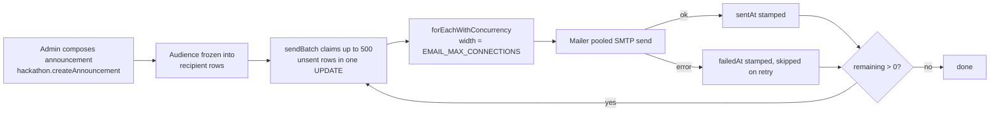

# Email

The site sends email for sign-in codes, hackathon acceptances and announcements, club decisions, and judging notices. This page covers how mail leaves the app, how mass sends are kept inside what the mail account and the host can take, and which send is resumable. Organisers use the sends. Developers adding a template or a new bulk send should follow the pattern here.

Provider setup (SMTP host, user, password, `EMAIL_FROM`) is in [`@query/auth`](../packages/auth.md) and [Environment](../operations/environment.md).

## Why limits exist

Production sends through a consumer Gmail account, about 500 recipients a day, shared with sign-in codes. A wave sized at the whole quota would leave no room for people signing in for the rest of the day. The host (Cloud Run) also kills a request at 300 seconds. So every bulk send is bounded, concurrent but not unlimited, and recorded per recipient so a killed request can be resumed without mailing anyone twice.

Switching to a bulk provider is a config change. Point `EMAIL_SERVER_*` and `EMAIL_FROM` at it and raise the limits below.

## How a message is sent

`packages/auth/src/email.ts`.

- `Mailer` owns one process-wide pooled SMTP transport (`pool: true`), built on first send. `EMAIL_MAX_CONNECTIONS` (default 5) and `EMAIL_MAX_MESSAGES` (default 100) tune it. A transport per message paid a full connect and login for every recipient.
- Every template calls `sendTransactionalEmail`, which hands a `TransactionalEmail` (`email`, `subject`, `heading`, `paragraphs`, optional `ctaLabel` and `ctaUrl`) to `mailer.send`. That function renders the shared HTML shell and a plain-text alternative. Paragraphs are escaped and wrapped, so a name or an organiser's text cannot become markup. A link is only ever added through `ctaUrl`.
- The sender is `EMAIL_FROM`, default `noreply@datasciencegt.org`.

Templates:

| Function | Sent when |
| --- | --- |
| `sendAcceptanceEmail` | Participant accepted to a hackathon |
| `sendAnnouncementEmail` | Organiser announcement |
| `sendRegistrationOpenEmail` | Registration opens, to the interest list |
| `sendJudgeApprovedEmail`, `sendJudgeAddedEmail` | Judge approved or added |
| `sendJudgingTimesPostedEmail` | Judging itinerary published |
| `sendResultsPublishedEmail` | Results published |
| `sendJudgingClaimEmail` | Claim link for a Devpost-imported team member |
| `sendInitiativeDecisionEmail` | Club project application or proposal decided |
| `sendSubteamApplicationEmail` | Subteam application received, accepted or rejected |

### Sign-in codes are separate

The email sign-in code is sent by the NextAuth Nodemailer provider in `packages/auth/src/config.ts`, not by `Mailer`. It builds its own transport from the same `EMAIL_SERVER_*` settings, so it shares the account but not the pool. The code is 6 digits from `randomInt`, expires in 10 minutes, and replaces any earlier code for that address. One code email goes out per address per minute: a repeat inside that minute sends nothing and the live code stays valid. An advisory lock per address stops parallel requests from each sending one.

## Fan-out

`packages/api/src/services/fanout.ts`.

- `forEachWithConcurrency(items, limit, worker)` runs a bounded number of workers at once. The worker must catch its own errors, because a rejection aborts the rest.
- `emailConcurrency()` returns `EMAIL_MAX_CONNECTIONS` (default 5, minimum 1), matching the pool. More would only queue inside nodemailer.

Sequential sends outran 300 seconds at a few hundred recipients; the pool width fixes that without opening more connections than the provider tolerates.

## Limits

| Limit | Value | Where |
| --- | --- | --- |
| Recipients per acceptance request | 200 (`MASS_EMAIL_BATCH`) | `services/email-limits.ts`, used by `sendMassAcceptanceEmails` and the attendees table, which sends in chunks of this size |
| Recipients per announcement request | 500 | `MAX_RECIPIENTS_PER_CALL` in `hackathon/announce.ts`. `hackathon/interest.ts` has its own constant of 500 for the registration-open mail |
| Acceptance wave size | 1 to 500 | `acceptWave` in `hackathon/admin.ts`. The admin UI limits a wave to 200 (`MASS_EMAIL_BATCH`); the comment in `admin.ts` saying the two match is wrong |
| Claim timeout | 15 minutes | A claimed but unsent recipient can be claimed again after this, so a killed request does not strand rows |
| Announcement test sends | 3 burst, then 1 per 10s per admin | `sendTestToMe` |
| Subject, heading, body | 200, 200, 5000 characters | `messageInput` |
| Button label | 60 characters. A button needs both a label and an http(s) link, or neither | `announce.ts` |
| SMTP pool | 5 connections, 100 messages each | `EMAIL_MAX_CONNECTIONS`, `EMAIL_MAX_MESSAGES` |

`MASS_EMAIL_BATCH` is exported from `@query/api/email-limits` so the browser and the procedure agree. If the chunk were larger than the procedure accepts, every send would fail validation.

## Resumable sends

Two of the bulk sends are built so a closed tab, a deploy, or a Cloud Run timeout does not repeat or lose mail.

### Announcements

Composing and sending are two steps (`routers/hackathon/announce.ts`). `createAnnouncement` freezes the message and the audience. `sendBatch` (admin) claims the next batch of unsent rows, sends them, and returns `{ sent, failed, remaining, done }`. The client calls it until `done`. The claim is one atomic UPDATE, so two overlapping requests get different rows rather than the same ones. A failed address is stamped and not retried on every batch, which would stall the loop on a permanent bounce.

Audiences: `interested`, `registered`, `approved`, `checked_in`, `not_accepted`, `waitlisted`, `rejected`. Rejected and waitlisted participants are left out of `registered` (pending, approved, checked in), `approved` and `checked_in`, so "see you this weekend" never reaches someone turned down. `interested` is the interest list as is. An announcement can be in-app only, which writes recipient rows already marked delivered. Hackers see the latest three announcements on their event page.

### Acceptance and registration-open

`sendMassAcceptanceEmails` stamps `acceptance_email_sent_at` on each participant immediately after their message. A rerun skips stamped people unless `resend` is set, which is how a killed batch is resumed. `notifyRegistrationOpen` (interest list, admin) claims and stamps per recipient the same way and refuses to send unless the edition is `open` or `in_progress`.

Judging notices (`services/judging/notify.ts`, `judging.hacker`) send one message per unique address (`uniqueAddresses`), using the account email for linked people and the Devpost email otherwise. They run after the publish commits, log failures, and never fail the publish. Claim emails stamp `sent_at` per message.

## Rules for any new send

1. Build the message with `sendTransactionalEmail` or a new template next to the others in `email.ts`. Do not write HTML in a router.
2. Send after the database write commits, never inside the transaction, and catch the error. Club decision emails (`subteam.ts`, `initiative.ts`) log a failure and keep the decision.
3. For more than a few recipients, use `forEachWithConcurrency(items, emailConcurrency(), ...)` and a per-recipient marker written right after each send.
4. Cap the request size and say where the cap is documented.

## Code and tests

| What | Where |
| --- | --- |
| Mailer and templates | `packages/auth/src/email.ts` |
| Sign-in code | `packages/auth/src/config.ts` |
| Fan-out | `packages/api/src/services/fanout.ts` |
| Batch size | `packages/api/src/services/email-limits.ts` |
| Bulk sends | `packages/api/src/routers/hackathon/announce.ts`, `admin.ts`, `interest.ts`, `packages/api/src/services/judging/notify.ts` |
| Tests | `services/fanout.test.ts`, `.internal-tests/announcements.test.ts`, `hackathon-interest.test.ts` |
