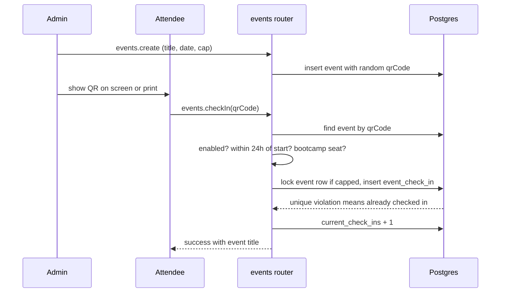

# Club events and check-in

Club events are the meetings, workshops and bootcamp sessions the club runs through the year. Staff create an event and get a QR code. Anyone signed in can scan that QR to record attendance, member or not. Officers at the door can also scan a member's pass or look someone up by email. The public `/events` page lists what is coming. Bootcamp sessions show on `/bootcamp` instead (see [Club events and bootcamp sessions](#club-events-and-bootcamp-sessions)).

These are separate from hackathon weekend events, which have their own tables, points and rules. See [Hackathons](./hackathons.md) and [Points](./points.md).

## Club events and bootcamp sessions

Both are rows in the `event` table. A bootcamp session has `bootcamp_term` set (see `create` below); a club event does not. Check-in works the same for both.

- `/events` lists club events only. Its queries filter `isNull(events.bootcampTerm)`.
- `/bootcamp` (`sites/mainweb/app/bootcamp/page.tsx`) lists the current term's sessions (`currentTerm()`), up to 30, split into upcoming and past. It is a server page revalidated every 300 seconds. The summary row comes from `bootcampSummary` in `lib/public-events.ts`: next session, time and room; or the last session once all have passed; or the planned start date and room before any are posted.
- `/bootcamp` shows the syllabus only when the term has no sessions, and always shows a "Join in the portal" link to `/club/bootcamp` for the $10 add-on.
- Sessions from earlier terms do not appear on either public page.

## Check-in flow

`events.checkIn` runs in one transaction and refuses in this order:

| Check | Error |
| --- | --- |
| No event has that `qrCode` | `NOT_FOUND` "Invalid QR code" |
| `checkInEnabled` is false | `BAD_REQUEST` |
| Event started more than 24 hours ago | `BAD_REQUEST` "Check-in for this event has closed" |
| `bootcampOnly` and the caller's `bootcampTerm` is not the session's term | `FORBIDDEN` |
| Already has a row for this event | `CONFLICT` "Already checked in" |
| `currentCheckIns >= maxCheckIns` (row locked `FOR UPDATE`, only when capped) | `BAD_REQUEST` "Event is full" |

There is no earliest time: a scan is accepted before the event starts. Membership is not checked. The member row is looked up only so a member's check-in carries `member_id`. The `events.membersOnly` column is no longer read.

The 24 hour limit matches the public list, which stops marking an event open after the same cutoff, so a photographed QR cannot keep admitting people.

## Officer tools

Officers need the scanner gate (`isScanner`: any active, unexpired admin row, volunteers included).

| Tool | Procedure | Behaviour |
| --- | --- | --- |
| Scan a member's pass | `scanMemberPass` | Looks up `member.pass_code`. `NOT_FOUND` "Unrecognised pass. It may have been rotated." Returns whether the membership is active. Does not check `checkInEnabled` or the 24 hour limit |
| Check in by email | `manualCheckIn` | The person must already have an account. Method is stored as `manual` |
| See the roster | `attendees` | 50 per page by default, max 200, newest first |
| Undo | `removeAttendance` | Deletes the row and decrements `current_check_ins` (never below zero) |

The three check-in writes (`checkIn`, `manualCheckIn`, `scanMemberPass`) share the capacity lock and the unique `(event_id, user_id)` index, so a double tap or two stations scanning the same person produce one row. A member's pass is a UUID rotated with `member.rotatePass`; see [Membership](./membership.md).

Volunteers can use the scanner at `/scan/club`. The attendance metrics on that page are a staff query, so volunteers get the scanner open by default and no charts.

## Managing events (admin)

Staff gate is `isAdmin` (full staff; bug testers read only).

| Procedure | Notes |
| --- | --- |
| `create` | Title 200, description 1000, location 200. Optional `maxCheckIns` (positive integer), `bootcampWeek` (1 to 52), `bootcampOnly`. Generates the `qrCode`. Sets `bootcampTerm` from the server clock when a week is given |
| `update` | Edit in place so the printed QR and the check-ins survive. A cap below the current count is refused (`CONFLICT`). `null` clears the cap or removes the bootcamp week |
| `regenerateQR` | New `qrCode`. The old one stops working |
| `toggleCheckIn` | Turns check-in on or off |
| `delete` | Deletes the event and all its check-ins |
| `listAll` | Up to 100, newest first, with creator. Cached 30s |
| `getById` | One event with every check-in, user and member name |
| `attendanceMetrics` | `range` of `term` (default), `90d`, `all`. Events held, check-ins, unique attendees, average per event, active members who attended. Aggregated in SQL, cached 60s per range |

A bootcamp week is unique per term (`event_bootcamp_session_idx` on `bootcamp_week, bootcamp_term`). Creating week 3 twice returns `CONFLICT` "Week 3 of this bootcamp already has a session." Bootcamp sessions are rows of the same table, so their attendance is the same `event_check_in` data. See [Bootcamp materials](../bootcamp-materials.md).

`attendanceMetrics` treats the term as starting 1 January (spring) or 1 June (fall) in Eastern time.

## Reads for attendees

| Procedure | Gate | Returns |
| --- | --- | --- |
| `list` | public | Up to 50 events, newest first, with `status` of `open` or `closed`. `qrCode` is stripped. Cached 30s, one key for all visitors |
| `myEvents` | protected | Own last 50 check-ins with event details. Cached 60s |
| `myStats` | protected | `{ totalEvents }`. Cached 60s |

Every write that changes an event or a check-in clears `event*` cache keys.

## Pages

| Route | What |
| --- | --- |
| `/events` | Public. Server-rendered straight from the database (no tRPC), revalidated every 300 seconds. Club events only (no bootcamp sessions). Upcoming events from the start of today in Eastern time, then past events with their attendance. `qrCode` is never selected. Shows "Full" when the cap is reached |
| `/checkin` | Any signed-in user. Opens the camera scanner and shows their count. Signed-out visitors are sent to `/login` and back |
| `/club` | Member hub with the same scanner and the member's own pass QR |
| `/admin` | Staff event list: create, edit, toggle, QR modal, attendance modal |
| `/admin/attendees` | Per-event attendee view |
| `/scan/club` | Officer scanner plus attendance charts (`ClubAttendanceMetrics`) |

The scanner hook (`components/portal/EventCheckIn.tsx`) also recognises a hackathon event poster, which is a link to `/hackathons/<id>/checkin`, and sends the user there instead of treating it as a club code.

## Data

`packages/db/src/schemas/events.ts`.

| Table | Key columns |
| --- | --- |
| `event` | `title`, `event_date`, `qr_code` (unique), `check_in_enabled`, `max_check_ins`, `current_check_ins`, `bootcamp_week`, `bootcamp_term`, `bootcamp_only`, `created_by_id` |
| `event_check_in` | `event_id`, `user_id`, `member_id` (null for non-members), `check_in_method` (`qr_code` or `manual`), `checked_in_at`. Unique on `(event_id, user_id)` |

`current_check_ins` is a counter kept in step with the rows. It is the capacity check, so every insert and delete moves it in the same transaction.

## Code and tests

| What | Where |
| --- | --- |
| Router | `packages/api/src/routers/events.ts` (mounted as `events`) |
| Eastern day helper | `packages/api/src/services/eastern-time.ts` (`startOfEasternDay`, shared with the site) |
| Public page | `sites/mainweb/app/events/page.tsx` |
| Components | `sites/mainweb/components/portal/EventCheckIn.tsx`, `EventQR.tsx`, `EventFormModal.tsx`, `EventAttendanceModal.tsx`, `ClubScannerTab.tsx`, `ClubAttendanceMetrics.tsx` |
| Tests | `packages/api/src/.internal-tests/qr-checkin.test.ts`, `club-attendance.test.ts`, `eastern-day.test.ts` |
