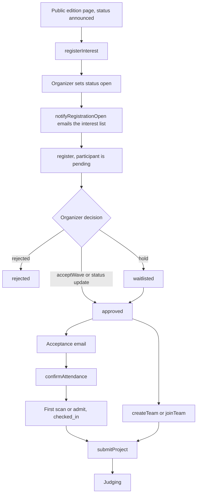

# Hackathons

A hackathon is one edition (for example Hacklytics 2027) stored as a `hackathon` row. Hackers move through it from interest to registration to check-in to submission. Organizers create the edition, control who sees it, run acceptance, send announcements and run event check-in. Judging has its own pages: see [Judging](../judging/README.md).

The marketing site is separate. [`sites/hacklytics2027`](../sites/hacklytics2027.md) has no database; its "Notify me" and portal links send visitors to this portal, which owns everything below.

## The hacker's path

Steps, with the procedure that does each (under `trpc.hackathon.*` unless noted):

1. **Interest.** `registerInterest` stores a `hackathon_interest` row (school, country, graduation year, experience). `withdrawInterest` removes it. `getUpcoming` is public so the coming-soon page renders for signed-out visitors; `myInterest` tells a signed-in user whether they are on the list. Banned users are refused.
2. **Register.** `register` requires status `open` and a deadline that has not passed, and refuses a second registration. It writes a `pending` participant with the consent answers (three consents must be true: the code of conduct, the MLH code of conduct and MLH data sharing). It does not claim a seat: capacity counts accepted people, so applying is never refused for being full. If the user has a membership, `member_id` is linked.
   An application in progress is saved as a draft and mailed a reminder if left for three days: see Saved drafts and the reminder below.
   The Ramadan fasting answer (`ramadanFasting`) is optional on the server: the form asks it only when the event's dates overlap Ramadan (`overlapsRamadan` in `sites/mainweb/lib/ramadan.ts`, Umm al-Qura calendar on the venue's days) and sends nothing otherwise, so the column is empty for those events.
3. **Edit or leave.** `updateMyRegistration` edits answers (consent fields are not re-sent) and only works while the edition is `open`, before the deadline, and while the participant is still `pending`. `withdrawRegistration` takes the registration back, but is refused once the person is on a team, checked in, or has a project, because that affects others, and once the edition is `completed` or `cancelled`.
4. **Decision.** An organizer accepts, rejects or waitlists (see Acceptance below). `checked_in` can only be reached from `approved`.
5. **Confirm.** `confirmAttendance` lets an accepted hacker say they are coming. It stamps `attendance_confirmed_at` once, so organizers can free the seats of people who never answer. It also opens the [Discord](./discord.md) step: an accepted hacker cannot link until they have answered.
6. **Check in.** The first event scan or desk admit moves `approved` to `checked_in` and stamps `checked_in_at`. See Hackathon events and check-in.
7. **Team.** `createTeam`, `joinTeam`, `leaveTeam`, `disbandTeam` and `setOpen` live in `packages/api/src/routers/team.ts` and need an accepted participant (`approved` or `checked_in`), so teams can form before check-in. The team window closes 34 hours after hacking starts. Leave and disband are refused within 12 hours of the submission deadline.
8. **Submit.** `submitProject` (same router) requires `checked_in`. Submissions open 12 hours after hacking starts, close at 36 and edits close at 34. Times count from `hacking_start_time`, else `start_date`. Solo entries are allowed. `withdrawProject`, `mySubmission` and `submissionWindow` are in the same file. How submissions become judging entries is covered in [Judging](../judging/README.md).

Participant status values: `pending`, `approved`, `rejected`, `waitlisted`, `checked_in`.

## Saved drafts and the reminder

The application form saves as the person fills it in, so an unfinished application survives a closed tab or a change of device, and so the server knows who started and stopped.

**Draft.** `hackathon_application_draft` holds one row per person per edition: `data` (jsonb), `created_at`, `updated_at` and `reminder_sent_at`. The form (`RegistrationForm.tsx`) saves 1.5 seconds after the last change and again on every step change and Cancel, through `saveMyDraft`, and shows "Saving…" or "Draft saved" under the buttons. `getMyDraft` reads it back. On open the form takes whichever of the server draft and the browser draft (`localStorage`, still kept as the offline fallback) was saved later.

- `data` is the form's own answers, as typed. The input schema (`services/application-drafts.ts`) lists the allowed fields and drops every other key, so a draft never holds citizenship, fasting, the consents, the resume file, or phone, age, gender, race and the emergency contact, which the browser draft also leaves out. A draft over 32 KB as JSON is refused.
- `saveMyDraft` is for signed-in people who are not banned, 120 saves an hour each. It is refused when the edition is not `open`, the deadline has passed, or the person already has a participant row. `register` deletes the draft in the same transaction that inserts the participant. Withdrawing has no draft to touch.

**Reminder.** `sendApplicationReminders(db, now)` (`services/application-reminders.ts`) mails one reminder per draft. A draft qualifies when all hold:

- it was last saved three days ago or more (`updated_at <= now - 3 days`) and `reminder_sent_at` is null;
- the edition is `open` and its deadline, if any, is still ahead;
- the person has no participant row for the edition, is not a judge for it, and is not banned.

It sends at most 200 a run, oldest first, with the Hacklytics look for editions named Hacklytics (`sendApplicationReminderEmail` in `packages/auth/src/email.ts`). A draft is mailed once: the claim is one `UPDATE ... SET reminder_sent_at = now WHERE reminder_sent_at IS NULL` and only the rows it returns are mailed, so overlapping runs cannot double-send, and editing the draft later does not clear the stamp. The stamp comes before the mail, so a crash between the two costs one reminder rather than risking two. A mail the provider refuses has its stamp cleared, so the next run retries it. The 200 cap and the daily run keep this inside the mail account's daily limit, which sign-in codes and acceptances share.

### Reminder setup

App Hosting has no scheduler, so a daily job posts to `POST /api/cron/application-reminders` with `Authorization: Bearer <CRON_SECRET>`. The job is Cloud Scheduler, set up separately; nothing in the repository triggers it yet. The route answers 404 when `CRON_SECRET` is unset (so it does nothing until then), 401 on a wrong token, 429 past 10 calls an hour from one address, and 200 with `{ claimed, sent, failed }`. The same secret has to be in App Hosting and in the scheduler job. Once: The same daily run also finishes Discord role changes still pending and takes the volunteer role back from volunteers whose term has ended, capped at 15 people and 20 seconds a run (see [Discord](./discord.md#taking-roles-back)).

1. Generate a value: `node -e "console.log(require('crypto').randomBytes(32).toString('hex'))"`.
2. `firebase apphosting:secrets:set CRON_SECRET` and paste it, then `firebase apphosting:secrets:grantaccess CRON_SECRET --backend query`.
3. Uncomment the `CRON_SECRET` entry in `apphosting.yaml` and roll out. It stays commented until the secret exists, because a reference to a missing secret breaks the rollout.
4. Create a Cloud Scheduler job that sends `POST https://datasciencegt.org/api/cron/application-reminders` once a day (mid-morning Eastern is a good hour) with the header `Authorization: Bearer <the same value>`.
5. Run the job once by hand. A 200 means it works; a 404 means the App Hosting secret is missing, and a 401 means the two values differ. Running it again is safe: every draft is mailed at most once.

## Edition lifecycle and visibility

`hackathon.status` is one of `draft`, `announced`, `open`, `closed`, `in_progress`, `completed`, `cancelled`.

| Status | Meaning |
| --- | --- |
| `draft` | Staff only. Not listed, and `NOT_FOUND` by id for non-admins. |
| `announced` | Public and collecting interest. Takes no registrations. Not the edition memberships attach to. |
| `open` | Registration is open until `registration_deadline`. |
| `closed`, `in_progress`, `completed` | Later stages. |
| `cancelled` | Stays visible so registrants can see it is off. |

Rules in `packages/api/src/routers/hackathon/visibility.ts`:

- `STAFF_ONLY_STATUSES` is just `draft`.
- `assertHackathonVisible` guards the public child queries (results, team list and the like). A hidden edition answers `NOT_FOUND`, not `FORBIDDEN`, because saying it exists is most of the leak.

`is_public = false` is not handled in `visibility.ts`. `list` applies it (hides the edition from the public list, not from admins), `getById` ignores it on purpose, and `registerInterest` refuses non-public editions.

## Organizer tools

Roles come from `packages/api/src/middleware/procedures.ts`. `isAdmin` is full staff (bug testers can run queries only). `isSuperAdmin` guards delete. `isScanner` also admits volunteers, but only for badge scanning and its undo.

### Editions (`crud.ts`)

| Procedure | Who | Notes |
| --- | --- | --- |
| `list` | public | Hides `draft` and non-public editions for non-admins. Cached per caller type. |
| `listAll` | admin | Every edition. |
| `getById` | public | Takes an id, exact name or slug. |
| `create`, `update` | admin | Names must be unique, since they appear in admin links. End must follow start. |
| `delete` | super admin | Needs `confirmName` typed to match. Every child table (participants, teams, projects, events, announcements, legacy votes and results, all `judging_*`, points and store) cascades. |

### Acceptance (`admin.ts`)

| Procedure | Purpose |
| --- | --- |
| `adminGetAttendees`, `adminGetAttendeeIds`, `exportAttendees` | Roster, ids for bulk work, export. |
| `updateParticipantStatus`, `batchUpdateParticipantStatus` | Set a status by hand. Accepting checks seats. |
| `waveStatus`, `acceptWave` | Accept the oldest N pending applications as a numbered wave (1 to 500; the admin UI limits a wave to 200, `MASS_EMAIL_BATCH`). Never passes `max_participants`. Uses `SKIP LOCKED` so two organizers take different people. Approves only; it does not email. |
| `sendMassAcceptanceEmails` | Mails accepted people in batches. Resumable per person through `acceptance_email_sent_at`. |
| `analytics` | Counts for the dashboard. |

`max_participants` caps acceptances, not applications. Seats taken are counted from `approved` plus `checked_in` rows on every read (`currentParticipants` in hackathon reads) and under the hackathon row lock in `assertSeats`. A team's `currentMembers` is its participant rows the same way. Neither is a stored column.

### Interest list (`interest.ts`)

`listInterest` and `interestCount` read the list. `notifyRegistrationOpen` tells everyone on it that registration opened, marking each recipient before the next so a closed tab or second click resumes instead of double-mailing. `registrationOpenEmailStatus` reports total, sent, failed and pending.

### Announcements (`announce.ts`)

Compose and send are two steps so a send can resume.

1. `createAnnouncement` freezes the message and its audience into `hackathon_announcement_recipient` rows. `inAppOnly` publishes to event pages without email.
2. `sendBatch` claims up to 500 unsent recipients with one atomic update, then sends with bounded concurrency (`packages/api/src/services/fanout.ts`). A claim older than 15 minutes can be reclaimed.

Audiences: `interested`, `registered`, `approved`, `checked_in`, `not_accepted`, `waitlisted`, `rejected`. Rejected and waitlisted participants are left out of `registered` (pending, approved, checked in), `approved` and `checked_in`, so a "see you this weekend" never reaches someone turned down. `interested` is the interest list as is. Other procedures: `audienceCounts`, `listAnnouncements`, `sendTestToMe`, and `listForMe` (the latest 3, for a hacker's event page). Fan-out limits are in [Email](email.md).

### Bans (`bans.ts`)

`listBans`, `banFromHackathons`, `liftHackathonBan`. A ban is keyed by lowercase email in `hackathon_ban` and leaves club membership alone. Enforcement is the `notHackathonBanned` procedure, used by `register`, `registerInterest`, `updateMyRegistration`, `confirmAttendance`, `createTeam`, `joinTeam`, `submitProject`, the event-code `checkIn`, judge `register` and `judging.hacker.claimByEmail`, `claimByToken` and `invite`. Withdrawing is not blocked. Ban and unban write audit records and clear the ban cache.

### Volunteers (`routers/volunteer/`)

A volunteer runs the weekend (check-in, meals, rooms, help for hackers). It is its own application, separate from [judging](judge-portal.md): different questions, a different table, a page at `/hackathons/<slug>/volunteer` that says plainly volunteers do not judge and links to the judge application, and the judge register page links back.

- **Questions** (`@query/db/constants`, `volunteer.ts`): affiliation (Georgia Tech student, student elsewhere, alum, industry), availability by time block (nine blocks: Friday afternoon setup, check-in and opening, overnight; Saturday morning, afternoon, evening, overnight; Sunday morning, closing and teardown; at least one), roles wanted (seven, optional), experience (optional), shirt size, dietary restrictions (with an Other text, as the hacker form), a phone for day-of contact, and the acknowledgement that volunteers are confirmed by organizers and must join the Discord. Three steps in `VolunteerForm`. The answers are one `jsonb` column validated by `volunteerAnswers` in `services/volunteer.ts`, which drops unknown keys, orders the blocks and refuses an empty availability.
- **Status** (`hackathon_volunteer_application.status`): `pending`, `approved`, `declined`, `withdrawn`. One row per person per edition. The applicant can edit while `pending` (`volunteer.update`) and withdraw from `pending` or `approved` (`volunteer.withdraw`, not behind the ban check, so a way out stays open). A withdrawn application can be reopened with `volunteer.submit` while the edition takes applications. Declined is final for the applicant.
- **Window.** `volunteer.submit` needs a public edition in status `announced` or `open` and the event not yet started: the deadline is `hackathon.start_date`. A `closed` edition refuses new applications as well. Corrections to a pending application are allowed until the edition ends. `volunteer.myApplication` returns the application with `accepting` and `canEdit`, which is what the page reads.
- **Organizers** (Volunteers tab next to Judges in the hackathon admin): `volunteer.list` (filters: status, role, time block; coverage counts per block and role, split approved and pending, over everyone so the counts do not move with the filters), `volunteer.decide` (approve or decline; `isAdmin`, so bug testers and scanner volunteers are refused; audited as `volunteer.approve` and `volunteer.decline`; either can follow the other; a withdrawn application cannot be decided) and `volunteer.exportApplications` (the filtered rows, audited as `volunteer.export`). `list` and `exportApplications` also refuse bug testers: the answers hold phone numbers. The CSV is built in the browser by `lib/volunteer-csv.ts`.
- **Emails** (`sendVolunteerApprovedEmail`, `sendVolunteerDeclinedEmail`, Hacklytics theme for a Hacklytics edition): sent once, on the transition into the status, and best-effort. Nothing is sent on submit.
- **Approving does not grant the `volunteer` staff tier.** That tier is check-in scanner access, and organizers still grant it deliberately on the Staff page. The Volunteers tab says so.
- **Discord.** Eligibility for the volunteer Discord role should use `isApprovedVolunteer(db, userId, hackathonId)` from `@query/api/volunteer` (`packages/api/src/services/volunteer.ts`), not the staff tier and not the table directly. It is true only for an `approved` application at that edition, so a withdrawal or a decline takes it away.
- **Phone.** It lives in `answers.phone` and is only used for contact during the event. Nothing deletes it afterwards yet.

### Content (`content.ts`)

| Procedure | Purpose |
| --- | --- |
| `getResults` | Public results: frozen `hackathon_result` rows plus room-judging placements. Visibility-checked and cached. |
| `projects`, `getPublicProjects` | Submitted projects for the gallery. |
| `myParticipantRecord` | The caller's own participant row. |
| `adminUpdateProject`, `adminWithdrawProject` | Fix links and copy on a team's behalf, or pull a project. Deliberately narrow: not tracks, since tracks decide which judges see it. Pulling sets `withdrawn_by_admin_at`. |

### Hackathon events and check-in

`events.ts` manages the schedule of an edition. Event types: `workshop`, `meal`, `ceremony`, `activity`, `sponsor_session`.

- `createEvent`, `updateEvent`, `deleteEvent` and `adminGetEvents` are admin. `getEvents` is public.
- Each event has `points`, copied onto the attendance row at check-in so later edits change nothing already earned.
- Self check-in: `generateEventCheckInCode` and `clearEventCheckInCode` (admin) and `getEventCheckInCode` (scanner) manage a short code shown at the event. A hacker enters it through `checkIn` in `packages/api/src/routers/points/me.ts`. It works only when `self_check_in` is on, the hacker is already `checked_in`, and the time is from 15 minutes before the start to the end. See [Points](points.md).
- Staff check-in (`admin.ts`, scanner role): `scanParticipantPass` (QR pass), `admit` (name search at the desk, recorded as a manual check-in plus an audit entry), `searchEventCheckIn`, `manualEventCheckIn`, `getEventAttendees`, `removeEventAttendance`.

Rule breaks: a check-in is refused and rolled back if its time strictly overlaps an event the person is in, or it lands within 30 minutes (`CHECK_IN_GAP_MS`) of their last `checkedInAt`. Meals are exempt both ways. `packages/api/src/services/check-in-flags.ts` then writes a `hackathon_check_in_flag` row (one per person, event and conflicting event, with an attempt count). Organizers and judges read it as a flag on the team for prize review. Hackers never see it. Club-level events are in [Events](events.md).

## Data

Schema: `packages/db/src/schemas/hackathons.ts`.

| Table | Holds |
| --- | --- |
| `hackathon` | Edition: dates, deadline, status, `max_participants`, prizes, tracks, challenges, `is_public`, `judging_active`. |
| `hackathon_participant` | One per user per edition: status, form answers, consent, `acceptance_wave`, `attendance_confirmed_at`, `checked_in_at`, team link. |
| `hackathon_interest` | Interest list, with per-recipient email sent and failed stamps. |
| `hackathon_application_draft` | An unsubmitted application, one per user per edition, with the reminder stamp. Deleted when the person registers. |
| `hackathon_team`, `hackathon_project` | Teams (max 4 by default) and submissions (`draft`, `submitted`, `judging`, `winner`). |
| `hackathon_event`, `hackathon_event_attendee` | Schedule and who attended. |
| `hackathon_check_in_flag` | Refused check-ins, for prize review. |
| `hackathon_announcement`, `hackathon_announcement_recipient` | Messages and their frozen audience. |
| `hackathon_ban` | Banned emails. |
| `hackathon_volunteer_application` | A volunteer application, one per user per edition: status, answers (`jsonb`), reviewer and review time. Schema: `packages/db/src/schemas/volunteer.ts`. |

## Limits and edge cases

- Acceptance waves are 1 to 500 per call on the server (the admin UI limits a wave to 200, `MASS_EMAIL_BATCH`), capped at remaining seats.
- Announcements send up to 500 recipients per call.
- Application reminders send up to 200 per run.
- Delete is hard and cascades to participants, teams, projects and votes. Set `cancelled` instead if people should still see the edition.
- Hackathon, roster and registration lists are cached and evicted on writes, so a stale list for a few seconds is possible.

## Code and tests

- Routers: `packages/api/src/routers/hackathon/` (merged in `index.ts`) and `packages/api/src/routers/team.ts`.
- Services: `packages/api/src/services/check-in-flags.ts`, `packages/api/src/services/fanout.ts`, `packages/api/src/services/application-drafts.ts`, `packages/api/src/services/application-reminders.ts`, `packages/api/src/services/volunteer.ts`.
- Portal pages under `sites/mainweb/app/(portal)/`: `hackathons`, `hacklytics`, `submit`, `checkin`, `scan`, `admin/hackathons`. Admin components are in `sites/mainweb/components/admin/hackathons/` (`AcceptanceWaves`, `AnnouncementsTab`, `ScannerTab`).
- Tests in `packages/api/src/.internal-tests/`: `hackathon-flow`, `hackathon-admin-edge`, `hackathon-interest`, `participant-edge`, `qr-checkin`, `announcements`, `application-drafts.db` and `volunteer.db` (both need `TEST_DATABASE_URL`).
