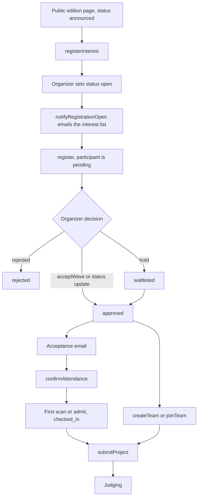

# Hackathons

A hackathon is one edition (for example Hacklytics 2027) stored as a `hackathon` row. Hackers move through it from interest to registration to check-in to submission. Organizers create the edition, control who sees it, run acceptance, send announcements and run event check-in. Judging has its own pages: see [Judging](../judging/README.md).

The marketing site is separate. [`sites/hacklytics2027`](../sites/hacklytics2027.md) has no database; its "Notify me" and portal links send visitors to this portal, which owns everything below.

## The hacker's path

Steps, with the procedure that does each (under `trpc.hackathon.*` unless noted):

1. **Interest.** `registerInterest` stores a `hackathon_interest` row (school, country, graduation year, experience). `withdrawInterest` removes it. `getUpcoming` is public so the coming-soon page renders for signed-out visitors; `myInterest` tells a signed-in user whether they are on the list. Banned users are refused.
2. **Register.** `register` requires status `open` and a deadline that has not passed, and refuses a second registration. It writes a `pending` participant with the consent answers (three consents must be true: the code of conduct, the MLH code of conduct and MLH data sharing). It does not claim a seat: capacity counts accepted people, so applying is never refused for being full. If the user has a membership, `member_id` is linked.
3. **Edit or leave.** `updateMyRegistration` edits answers (consent fields are not re-sent) and only works while the edition is `open`, before the deadline, and while the participant is still `pending`. `withdrawRegistration` takes the registration back, but is refused once the person is on a team, checked in, or has a project, because that affects others, and once the edition is `completed` or `cancelled`.
4. **Decision.** An organizer accepts, rejects or waitlists (see Acceptance below). `checked_in` can only be reached from `approved`.
5. **Confirm.** `confirmAttendance` lets an accepted hacker say they are coming. It stamps `attendance_confirmed_at` once, so organizers can free the seats of people who never answer.
6. **Check in.** The first event scan or desk admit moves `approved` to `checked_in` and stamps `checked_in_at`. See Hackathon events and check-in.
7. **Team.** `createTeam`, `joinTeam`, `leaveTeam`, `disbandTeam` and `setOpen` live in `packages/api/src/routers/team.ts` and need an accepted participant (`approved` or `checked_in`), so teams can form before check-in. The team window closes 34 hours after hacking starts. Leave and disband are refused within 12 hours of the submission deadline.
8. **Submit.** `submitProject` (same router) requires `checked_in`. Submissions open 12 hours after hacking starts, close at 36 and edits close at 34. Times count from `hacking_start_time`, else `start_date`. Solo entries are allowed. `withdrawProject`, `mySubmission` and `submissionWindow` are in the same file. How submissions become judging entries is covered in [Judging](../judging/README.md).

Participant status values: `pending`, `approved`, `rejected`, `waitlisted`, `checked_in`.

## Edition lifecycle and visibility

`hackathon.status` is one of `draft`, `announced`, `open`, `closed`, `in_progress`, `completed`, `cancelled`.

| Status | Meaning |
| --- | --- |
| `draft` | Staff only. Not listed, and `NOT_FOUND` by id for non-admins. |
| `announced` | Public and collecting interest. Takes no registrations. Not the edition memberships attach to. |
| `open` | Registration is open until `registration_deadline`. |
| `closed`, `in_progress`, `completed` | Later stages. |
| `cancelled` | Stays visible so registrants can see it is off. |

Rules in `packages/api/src/routers/hackathon/visibility.ts`:

- `STAFF_ONLY_STATUSES` is just `draft`.
- `assertHackathonVisible` guards the public child queries (results, team list and the like). A hidden edition answers `NOT_FOUND`, not `FORBIDDEN`, because saying it exists is most of the leak.

`is_public = false` is not handled in `visibility.ts`. `list` applies it (hides the edition from the public list, not from admins), `getById` ignores it on purpose, and `registerInterest` refuses non-public editions.

## Organizer tools

Roles come from `packages/api/src/middleware/procedures.ts`. `isAdmin` is full staff (bug testers can run queries only). `isSuperAdmin` guards delete. `isScanner` also admits volunteers, but only for badge scanning and its undo.

### Editions (`crud.ts`)

| Procedure | Who | Notes |
| --- | --- | --- |
| `list` | public | Hides `draft` and non-public editions for non-admins. Cached per caller type. |
| `listAll` | admin | Every edition. |
| `getById` | public | Takes an id, exact name or slug. |
| `create`, `update` | admin | Names must be unique, since they appear in admin links. End must follow start. |
| `delete` | super admin | Needs `confirmName` typed to match. Every child table (participants, teams, projects, events, announcements, legacy votes and results, all `judging_*`, points and store) cascades. |

### Acceptance (`admin.ts`)

| Procedure | Purpose |
| --- | --- |
| `adminGetAttendees`, `adminGetAttendeeIds`, `exportAttendees` | Roster, ids for bulk work, export. |
| `updateParticipantStatus`, `batchUpdateParticipantStatus` | Set a status by hand. Accepting checks seats. |
| `waveStatus`, `acceptWave` | Accept the oldest N pending applications as a numbered wave (1 to 500; the admin UI limits a wave to 200, `MASS_EMAIL_BATCH`). Never passes `max_participants`. Uses `SKIP LOCKED` so two organizers take different people. Approves only; it does not email. |
| `sendMassAcceptanceEmails` | Mails accepted people in batches. Resumable per person through `acceptance_email_sent_at`. |
| `analytics` | Counts for the dashboard. |

`max_participants` caps acceptances, not applications. `current_participants` is re-derived from `approved` plus `checked_in` rows by `syncCurrentParticipants`, which locks the hackathon row first.

### Interest list (`interest.ts`)

`listInterest` and `interestCount` read the list. `notifyRegistrationOpen` tells everyone on it that registration opened, marking each recipient before the next so a closed tab or second click resumes instead of double-mailing. `registrationOpenEmailStatus` reports total, sent, failed and pending.

### Announcements (`announce.ts`)

Compose and send are two steps so a send can resume.

1. `createAnnouncement` freezes the message and its audience into `hackathon_announcement_recipient` rows. `inAppOnly` publishes to event pages without email.
2. `sendBatch` claims up to 500 unsent recipients with one atomic update, then sends with bounded concurrency (`packages/api/src/services/fanout.ts`). A claim older than 15 minutes can be reclaimed.

Audiences: `interested`, `registered`, `approved`, `checked_in`, `not_accepted`, `waitlisted`, `rejected`. Rejected and waitlisted participants are left out of `registered` (pending, approved, checked in), `approved` and `checked_in`, so a "see you this weekend" never reaches someone turned down. `interested` is the interest list as is. Other procedures: `audienceCounts`, `listAnnouncements`, `sendTestToMe`, and `listForMe` (the latest 3, for a hacker's event page). Fan-out limits are in [Email](email.md).

### Bans (`bans.ts`)

`listBans`, `banFromHackathons`, `liftHackathonBan`. A ban is keyed by lowercase email in `hackathon_ban` and leaves club membership alone. Enforcement is the `notHackathonBanned` procedure, used by `register`, `registerInterest`, `updateMyRegistration`, `confirmAttendance`, `createTeam`, `joinTeam`, `submitProject`, the event-code `checkIn`, judge `register` and `judging.hacker.claimByEmail`, `claimByToken` and `invite`. Withdrawing is not blocked. Ban and unban write audit records and clear the ban cache.

### Content (`content.ts`)

| Procedure | Purpose |
| --- | --- |
| `getResults` | Public results: frozen `hackathon_result` rows plus room-judging placements. Visibility-checked and cached. |
| `projects`, `getPublicProjects` | Submitted projects for the gallery. |
| `myParticipantRecord` | The caller's own participant row. |
| `adminUpdateProject`, `adminWithdrawProject` | Fix links and copy on a team's behalf, or pull a project. Deliberately narrow: not tracks, since tracks decide which judges see it. Pulling sets `withdrawn_by_admin_at`. |

### Hackathon events and check-in

`events.ts` manages the schedule of an edition. Event types: `workshop`, `meal`, `ceremony`, `activity`, `sponsor_session`.

- `createEvent`, `updateEvent`, `deleteEvent` and `adminGetEvents` are admin. `getEvents` is public.
- Each event has `points`, copied onto the attendance row at check-in so later edits change nothing already earned.
- Self check-in: `generateEventCheckInCode` and `clearEventCheckInCode` (admin) and `getEventCheckInCode` (scanner) manage a short code shown at the event. A hacker enters it through `checkIn` in `packages/api/src/routers/points/me.ts`. It works only when `self_check_in` is on, the hacker is already `checked_in`, and the time is from 15 minutes before the start to the end. See [Points](points.md).
- Staff check-in (`admin.ts`, scanner role): `scanParticipantPass` (QR pass), `admit` (name search at the desk, recorded as a manual check-in plus an audit entry), `searchEventCheckIn`, `manualEventCheckIn`, `getEventAttendees`, `removeEventAttendance`.

Rule breaks: a check-in is refused and rolled back if its time strictly overlaps an event the person is in, or it lands within 30 minutes (`CHECK_IN_GAP_MS`) of their last `checkedInAt`. Meals are exempt both ways. `packages/api/src/services/check-in-flags.ts` then writes a `hackathon_check_in_flag` row (one per person, event and conflicting event, with an attempt count). Organizers and judges read it as a flag on the team for prize review. Hackers never see it. Club-level events are in [Events](events.md).

## Data

Schema: `packages/db/src/schemas/hackathons.ts`.

| Table | Holds |
| --- | --- |
| `hackathon` | Edition: dates, deadline, status, `max_participants`, `current_participants`, prizes, tracks, challenges, `is_public`, `judging_active`. |
| `hackathon_participant` | One per user per edition: status, form answers, consent, `acceptance_wave`, `attendance_confirmed_at`, `checked_in_at`, team link. |
| `hackathon_interest` | Interest list, with per-recipient email sent and failed stamps. |
| `hackathon_team`, `hackathon_project` | Teams (max 4 by default) and submissions (`draft`, `submitted`, `judging`, `winner`). |
| `hackathon_event`, `hackathon_event_attendee` | Schedule and who attended. |
| `hackathon_check_in_flag` | Refused check-ins, for prize review. |
| `hackathon_announcement`, `hackathon_announcement_recipient` | Messages and their frozen audience. |
| `hackathon_ban` | Banned emails. |

## Limits and edge cases

- Acceptance waves are 1 to 500 per call on the server (the admin UI limits a wave to 200, `MASS_EMAIL_BATCH`), capped at remaining seats.
- Announcements send up to 500 recipients per call.
- Delete is hard and cascades to participants, teams, projects and votes. Set `cancelled` instead if people should still see the edition.
- Hackathon, roster and registration lists are cached and evicted on writes, so a stale list for a few seconds is possible.

## Code and tests

- Routers: `packages/api/src/routers/hackathon/` (merged in `index.ts`) and `packages/api/src/routers/team.ts`.
- Services: `packages/api/src/services/check-in-flags.ts`, `packages/api/src/services/fanout.ts`.
- Portal pages under `sites/mainweb/app/(portal)/`: `hackathons`, `hacklytics`, `submit`, `checkin`, `scan`, `admin/hackathons`. Admin components are in `sites/mainweb/components/admin/hackathons/` (`AcceptanceWaves`, `AnnouncementsTab`, `ScannerTab`).
- Tests in `packages/api/src/.internal-tests/`: `hackathon-flow`, `hackathon-admin-edge`, `hackathon-interest`, `participant-edge`, `qr-checkin`, `announcements`.
