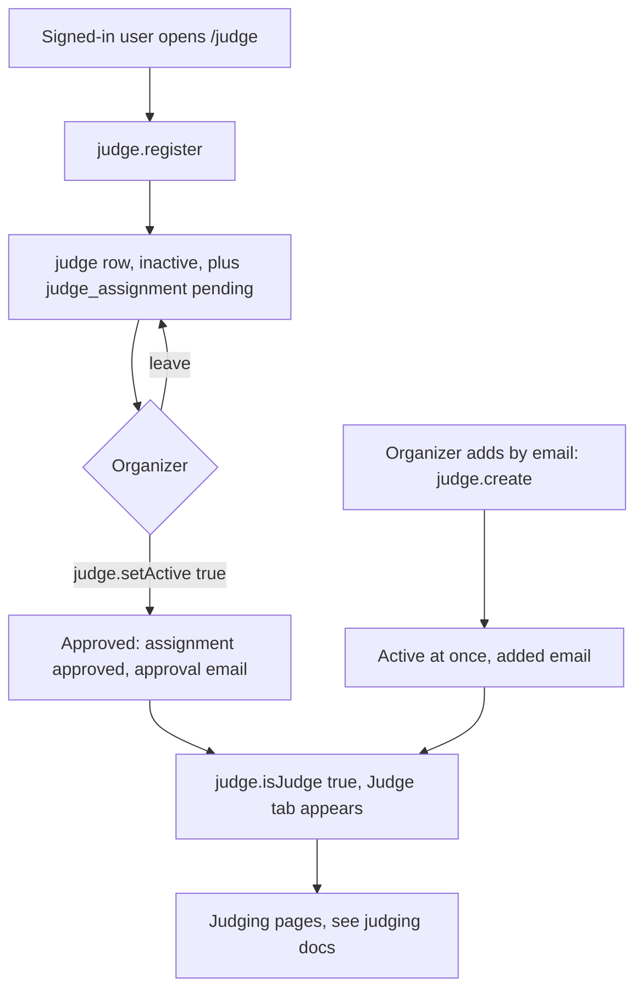

# Judge portal

`routers/judge` is the judge roster: people apply to judge an edition, organizers approve them (or add them directly), and the portal shows approved judges a Judge tab. It is small. Everything a judge does after approval (rooms, schedule, desk, scoring, results) lives in `routers/judging`, covered in [Judging](../judging/README.md).

## How it works

1. **Apply.** `judge.register` takes contact details, company, title, specialty, links, experience, dietary needs, shirt size, why they want to judge and a preferred track. It writes a `judge` row with `is_active = false` and a `judge_assignment` with status `pending`.
2. **Approve.** An admin calls `judge.setActive`. The assignment status mirrors it (`approved` or `pending`). The approval email is sent only on the transition from inactive to active, and a mail failure does not undo the approval.
3. **Walk-ins.** `judge.create` adds a sponsor or walk-in by email without an application. The person needs an account, which signing in once creates. The judge is active immediately and gets a separate "added as a judge" email.
4. **Use.** `judge.isJudge` returns whether the caller is an active judge for an edition. The portal shows the Judge tab from it.

## Procedures

All under `trpc.judge.*`, in `packages/api/src/routers/judge/`.

| Procedure | Who | File | Purpose |
| --- | --- | --- | --- |
| `isJudge` | signed in | `portal.ts` | Active judge for an edition? Defaults to the current edition. Cached 60 seconds. |
| `myApplications` | signed in | `portal.ts` | The caller's applications with track and whether approved. |
| `register` | signed in, not banned | `portal.ts` | Apply (above). |
| `list` | admin | `admin.ts` | Judges, optionally for one edition, with user and assignments. |
| `create` | admin | `admin.ts` | Add a judge by email or user id. |
| `setActive` | admin | `admin.ts` | Approve or revoke. |
| `remove` | super admin | `admin.ts` | Delete a judge. |

## Rules and edge cases

- **Which editions take applications.** The edition must be public and `announced`, `open`, `closed` or `in_progress`. Otherwise `NOT_FOUND`.
- **No double role.** A person registered as a participant in that edition cannot apply to judge it.
- **One application per edition.** A repeat returns `CONFLICT`. The `judge` row is unique per user and edition, and so is the assignment.
- **Preferred track.** It must match one of the edition's tracks or challenges (case-insensitive, stored in the edition's spelling) or `createX`. If the edition has none configured, leave it empty and an organizer places the judge.
- **Bans.** `register` uses `notHackathonBanned`, so a hackathon ban stops judge applications. See [Hackathons](hackathons.md).
- **Removal protection.** `remove` refuses a judge who has submitted votes, since the votes cascade. The vote table belongs to the retired pool-dispatch judging.
- **Cache.** Approval, creation and removal clear the per-user judge cache and the portal context, so the Judge tab appears (or goes) immediately instead of after the cache expires.
- **`judge.is_active` is the gate.** Judging procedures read it. `judge_assignment.status` only mirrors it.

## How it connects to judging

The roster is what judging reads: `judge.is_active` gates the judging procedures, and `judge_assignment.track` is read by the judging desk (`packages/api/src/routers/judging/desk.ts`). Organizers see the preferred track when seating judges. See [Judging setup](../judging/setup.md) for judges and scope, and [Judging day](../judging/judging-day.md) for what a judge sees at the event.

Guest judges (invite links) are a judging feature, not part of `routers/judge`. `/judge/guest/[hackathonId]` renders JudgeDesk (`trpc.judging.desk.*`); the route handler `/judge/activate/[linkId]` activates the room link and sets the guest cookie. Another page, `/hackathons/[id]/claim`, also uses `trpc.judging.hacker`.

## Data

Schema: `packages/db/src/schemas/judge.ts`.

| Table | Holds |
| --- | --- |
| `judge` | One row per person per edition: contact and background fields, `is_active`. |
| `judge_assignment` | The application: edition, `track`, `status` (`pending`, `approved`, `rejected`), `is_lead`. |

The same file also declares `judging_project`, `judge_vote`, `hackathon_result` and `judge_queue` from the retired pool-dispatch judging. Nothing writes them now, but past editions' data stays, and `hackathon.getResults` still reads `hackathon_result`.

## Code and tests

- Routers: `packages/api/src/routers/judge/index.ts`, `portal.ts`, `admin.ts`.
- Portal pages under `sites/mainweb/app/(portal)/judge/`: `page.tsx` (status and applications), `register/page.tsx` (form), `[hackathonId]/page.tsx` (renders the `JudgeDesk` component from judging), plus the guest pages above.
- Tests in `packages/api/src/.internal-tests/`: `judge-edge`, `assigned-judge`.
- The Hacklytics site footer has a Judge link that signs in and returns to `/judge`; see [Hacklytics 2027](../sites/hacklytics2027.md).
