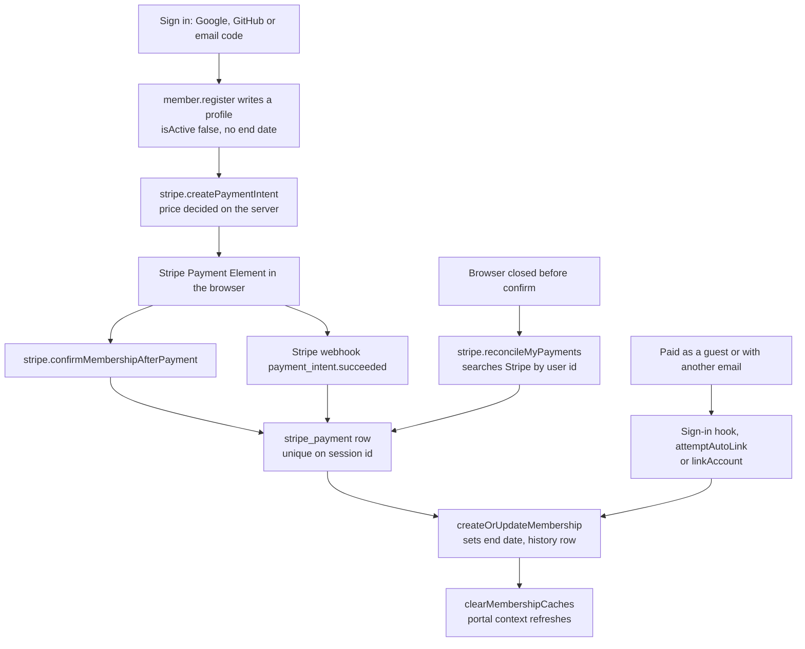

# Accounts, profiles and membership

Every person who signs in gets an account. Members are the subset who paid dues and still have time left on them. Signed-in users manage their profile in Settings. Staff grant or revoke memberships by hand when someone pays another way. The portal reads one cached payload, the portal context, to decide what each person sees.

Sign-in itself (Google, GitHub, email code, sessions) is in [`@query/auth`](../packages/auth.md). Paying for dues is in [Payments](./payments.md). Tables are in [`@query/db`](../packages/db.md).

## Three separate things

| Thing | Table | Created by | Means |
| --- | --- | --- | --- |
| Account | `user`, `account`, `session` | Sign-in | You can use the portal and the hackathon side |
| Profile | `user_profile` (bio, website, location, `gt_email`) | `user.updateProfile` | Optional extras, nothing is gated on them |
| Membership | `member`, `membership_history` | A completed payment, or staff | Club benefits |

`member.register` writes a member row with `isActive: false` and no end date. It is a profile, not a membership. Only `createOrUpdateMembership` (called after a payment) or a staff grant sets a term. A free `renew` procedure once let any signed-in user extend themselves, so there is none.

A person is a member when `isActive` is true and `membershipEndDate` is in the future. At least five places compute this and must agree: `buildMemberContext` (`services/portal-context.ts`), `member.checkStatus`, `member.adminSearch`, `events.scanMemberPass` and `events.attendanceMetrics`. A row whose date has passed is `hasLapsed`. A row switched off with a future date is a staff action, not a lapse.

Hackathon participation does not need membership. See [Hackathons](./hackathons.md).

## Joining and paying

The confirm call and the webhook race on purpose. Both write the same synthetic session id (`pi_<intent id>`), so the unique index lets one win and the other do nothing. Details of each path are in [Payments](./payments.md).

### What a payment grants

`createOrUpdateMembership` in `packages/db/src/services/membership.ts` is the one place a payment sets a term; staff grant/revoke (`member.adminGrant`, `member.adminRevoke`) are the only other writers. The sign-in hook, the tRPC router, the Stripe webhook and the verify-email route all call it.

| Rule | Behaviour |
| --- | --- |
| Annual plan | End date is one year after the term start |
| Semester plan | End date is the end of the current semester (31 May or 31 Dec, 23:59:59.999 Eastern) |
| Renewing early | The new term starts where the old one ends, so no time is lost |
| Renewing after a lapse | The term starts today, with no credit for the gap |
| `addOnOnly` ($10 bootcamp) | Stamps `bootcampMember` and `bootcampTerm` only. No new term, no history row. A no-op when there is no member row |
| No member row | Inserts the row with `memberType: "new"` and a `joined` history row |
| Any existing row, including a profile-only one from `member.register` | Sets `memberType: "continuous"`, adds 1 to `renewalCount`, adds a `renewed` history row |

A membership is keyed on the person, not on a hackathon edition. An older design tied it to an edition and every member read as lapsed the day a new edition opened. `membership_history` is the only record of which years someone was a member, because renewals overwrite `membershipEndDate`.

Bootcamp access is per semester. `currentTerm()` returns `YYYY-spring` for January to May and `YYYY-fall` for June to December, in Eastern time. Bootcamp check-in compares `bootcampTerm` against the session's own term (`event.bootcampTerm ?? currentTerm()`), not the current term. See [Bootcamp materials](../bootcamp-materials.md).

## Portal context

`user.getPortalContext` returns what the sidebar, dashboard and admin layout gate on. `fetchPortalContext` runs four reads in parallel: the `admin` row, the `judge` row, the `project_leader` row and the `member` row.

| Field | Source |
| --- | --- |
| `isAdmin` | Active, unexpired `admin` row with role `super_admin`, `admin` or `moderator` |
| `isScanner` | Any active, unexpired `admin` row, volunteers included |
| `isBugTester` | Role `bug_tester` (read-only QA) |
| `isJudge`, `judgeId`, `judgeName` | Active `judge` row |
| `isProjectLeader` | Active `project_leader` row, or staff |
| `member` | `isMember`, `isActive`, `hasLapsed`, `expiresAt`, `daysRemaining`, `memberType`, `renewalCount` |

It is cached 300 seconds per user. Every writer that changes membership, a staff role or a leader appointment evicts it (`clearMembershipCaches`, `invalidatePortalContext`, `clearProjectLeaderCaches` in `middleware/cache.ts`). The sign-in hook lives in `@query/db`, which cannot import the cache, so `portal-context.ts` registers `setMembershipChangeHandler(clearMembershipCaches)` and the hook calls it through that.

`resolveHackathonId` (same file) picks the default hackathon when none is named: the edition running now (status not draft or announced, start <= now <= end), else the newest by start date whose status is not draft or announced, cached 60 seconds.

## Procedures

Gate names are defined in `packages/api/src/trpc.ts` and `middleware/procedures.ts`; see [`@query/api`](../packages/api.md) for what each one checks.

### `user` (`routers/user.ts`)

| Procedure | Gate | Notes |
| --- | --- | --- |
| `me` | protected | Name, image, profile fields. Cached 120s |
| `getPortalContext` | protected | See above. Cached 300s |
| `updateProfile` | protected | At least one field. `image` and `website` must be valid URLs. The schemes `javascript:`, `data:`, `vbscript:` and `file:` are refused (a denylist, so an old `mailto:` entry does not block saving other fields). `gtEmail` must end in `gatech.edu` (subdomains allowed), is lowercased, and is unique across accounts. `""` clears `website` and `gtEmail`. A duplicate `gtEmail` returns `CONFLICT` |
| `updateProfileImage` | upload (2MB cap) | Base64 data URL, JPEG, PNG or WebP. The file signature is read, not trusted. Max 2000 x 2000 pixels. Stored in the `user.image` column |

Text limits: name 100, bio 500, website 500, location 200.

### `member` (`routers/member.ts`)

| Procedure | Gate | Notes |
| --- | --- | --- |
| `me` | protected | Own member row or `null`. Cached 60s, negatives included |
| `register` | protected | Creates the profile row. `BAD_REQUEST` if one exists. Names allow letters from any script, spaces, hyphens, apostrophes. Graduation year 2024 to 2035. Up to 20 skills and 20 interests, 50 chars each |
| `update` | protected | Phone, school, major, graduation year and the URLs accept `null` to clear; names, skills and interests are optional only |
| `checkStatus` | protected | The status object, cached 30s |
| `history` | protected | Own last 50 `membership_history` rows. Cached 60s |
| `myPass` | protected | `passCode`, the UUID in the member's QR |
| `rotatePass` | protected | New `passCode` via `gen_random_uuid()`. Kills a shared or photographed pass |
| `list`, `getById` | admin | `list` is the active members directory (filters `isActive`), cached 60s per page, max 100 per page. `getById` returns any member row, active or not. Both omit phone numbers |
| `adminSearch` | admin | By email or name, up to 50 results |
| `adminHistory` | admin | Up to 100 history rows for one user |
| `adminGrant` | admin | `months` from -24 to 24 (not 0) and a required `note`. Adds to whatever term is left. In one transaction under a row lock. Audit severity `critical` |
| `adminRevoke` | admin | Sets `isActive` false and the end date to now. The row and history stay. Audit severity `critical` |

"admin" means the `isAdmin` gate: full staff, plus read-only bug testers on queries. Volunteers are rejected. `adminGrant` on a user with no member row creates one (`firstName` and `lastName` are split from the account name) and refuses a negative `months` there.

## Pages

| Route | What |
| --- | --- |
| `/login` | Sign-in. Hides the GitHub button when that provider is not registered |
| `/dashboard` | Home. Calls `stripe.attemptAutoLink`. Non-members and lapsed members see the pay or link block (`LinkStripeAccount`); members see it again when the term ends soon |
| `/settings` | Tabs: profile (name, photo, bio, resume), membership, appearance, account. `MembershipTab` reads `member.me`, `checkStatus`, `history` and calls `member.register` and `member.update` |
| `/club` | Member hub, redirects non-members to `/dashboard`: pass card (`MemberPassCard`), event check-in, stats |
| `/admin/members` | Staff search, history, grant and revoke (`app/(portal)/admin/members/page.tsx`) |

Resume upload and the resume book are in [Resume book](../resume-book.md).

## Limits and edge cases

- A lapsed member keeps the member row and history. They see a renew prompt, not a join prompt.
- Months removed by `adminGrant` can leave the term in the past. The row then reads as lapsed.
- A member with a year left who buys the bootcamp pays $10 and gets no extension. The server decides this from their own row, never from a client flag.
- A person can have one `member` row (`unique_member_per_user`).
- Staff reads of the member table drop `phoneNumber`.

## Code and tests

| What | Where |
| --- | --- |
| Routers | `packages/api/src/routers/user.ts`, `member.ts` |
| Portal context | `packages/api/src/services/portal-context.ts`, `types/portal-context.ts` |
| Membership rules | `packages/db/src/services/membership.ts` |
| Schema | `packages/db/src/schemas/members.ts`, `auth.ts` |
| Tests | `services/portal-context.test.ts`, `routers/user/portal-context.test.ts`, `packages/db/src/services/membership.test.ts`, `membership-edge.test.ts`, `.internal-tests/routers.test.ts`, `stripe-payments.test.ts` |
