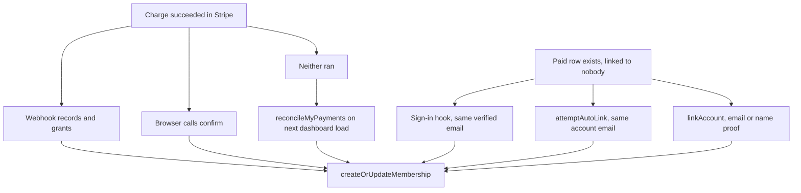

# Payments and pricing

Members pay club dues through Stripe. The portal sells one membership in two lengths, plus a bootcamp add-on. The server decides every price, records every charge in its own table, and has several independent ways to turn a recorded charge into a membership so that a closed tab or a missed webhook never leaves someone paid but not a member. Members use the payment modal. Staff watch the metrics and fix leftovers by hand in [Admin tools](./admin.md).

What a grant does to a member row is in [Membership](./membership.md). Alerts on this flow are in [Status and metrics](./status.md).

## Prices

All in `packages/api/src/services/pricing.ts`, in cents. The module is also exported to the client (`@query/api/pricing`) so the UI quotes the same numbers.

| Item | Cents | Notes |
| --- | --- | --- |
| Annual membership | 2500 | One year |
| Semester membership | 1500 | Ends 31 May or 31 Dec |
| Bootcamp add-on | 1000 | On top of either plan, or alone for an active member |
| Ceiling | 10000 | `MAX_MEMBERSHIP_CHARGE_CENTS`. Anything above is ignored by the webhook, confirm and reconcile |

`priceForCents(withBootcamp, plan)` is the quote. `entitlementForCents` maps an amount back to what it buys, and is used only for Checkout Sessions that carry no metadata (a payment link or a Dashboard charge). It is exact, not "at least": 2500, 1500, 3500 and 1000 buy something; any other amount buys nothing and the row is left for staff. A semester plus add-on (2500) reads as an annual year, which cannot short-change a buyer.

## Paying: the card flow

The modal (`components/portal/StripePaymentModal.tsx`, opened from `LinkStripeAccount` on `/dashboard` and `BootcampAddOn` on `/club/bootcamp`) uses a PaymentIntent and the Stripe Payment Element.

1. `stripe.createPaymentIntent` computes the amount. It looks up the caller's own member row: if the bootcamp is requested and the membership is active, the charge is 1000 and `type` is `bootcamp_addon`; otherwise it is the plan price. The client cannot ask for add-on pricing. Metadata on the intent: `userId`, `userEmail`, `type` (`membership` or `bootcamp_addon`), `plan`, `bootcamp`.
2. The browser confirms the card with Stripe.
3. The browser calls `stripe.confirmMembershipAfterPayment`. The server fetches the intent from Stripe, requires `status === "succeeded"`, `metadata.userId` equal to the caller, a known `type`, and an amount within the ceiling. A non-succeeded intent throws `BAD_REQUEST`, "Payment not yet complete (status: ...)"; a wrong user, unknown type or amount over the ceiling throws `FORBIDDEN`, "Payment mismatch." Plan and bootcamp flags come from the charged intent, never from the client. It inserts a `stripe_payment` row and calls `createOrUpdateMembership` in one transaction.
4. Independently, Stripe sends `payment_intent.succeeded` to the webhook, which does the same work for intents this app minted.

The confirm call and the webhook write the same session id, `pi_<intent id>`. `stripe_payment.stripe_session_id` is unique, so whichever lands second inserts nothing.

### Hosted Checkout

`stripe.createCheckoutSession` builds a hosted Stripe Checkout page (mode `payment`, same prices, `customer_email` set to the account). No page in `sites/mainweb` calls it today; it is exercised by tests and listed on the API docs page. The webhook still handles `checkout.session.completed` for it, and for payment links.

### Mock mode

When `STRIPE_MOCK_MODE=true` and `NODE_ENV` is not `production`, `createCheckoutSession` records a paid row and grants immediately, and `createPaymentIntent` returns a fake id (`pi_mock_`, `pi_mock_addon_`, `pi_mock_sem_`) that `confirmMembershipAfterPayment` accepts through the normal path. The webhook skips signature verification (and parses the body as plain JSON) in the same mode only; the `stripe-signature` header must still be present. In production none of this applies, and a missing signature is refused.

## Recovery paths

A charge can exist in Stripe with no membership. Each path below starts from a stored or searchable charge and is safe to run repeatedly.

| Path | Trigger | Proof of ownership |
| --- | --- | --- |
| Webhook | Stripe event | Signature, and `metadata.userId` or the receipt email |
| `confirmMembershipAfterPayment` | Browser after paying | Intent `metadata.userId` equals caller |
| `reconcileMyPayments` | Mutation fired on dashboard load | Stripe search `metadata['userId']:'<id>' AND status:'succeeded'`, 20 results, same ceiling check. Keeps only `metadata.type === "membership"`, so a lost `bootcamp_addon` charge is not recovered this way (confirm and the webhook accept both types). Re-grants a linked payment only if `membership_history` has no row at or after the payment time |
| Sign-in hook | Every sign-in (`events.signIn` in `packages/auth/src/config.ts`) | Provider-verified email equals `customer_email`. Errors are swallowed so login never fails |
| Verify-email route | Email-code sign-in (`api/auth/verify-email/route.ts`) | Same email rule |
| `attemptAutoLink` | Dashboard load | Account email equals `customer_email`. Rate limited to one call per 10 seconds per user |
| `linkAccount` | User types first name, last name, email | Email on the payment equals the account email, **or** the typed name tokens all appear in the payer name (at least two tokens). Failure messages match "no payment" so the form cannot probe which emails have unclaimed payments |

The sign-in hook, the verify-email route, confirm and reconcile claim a payment with `linked_user_id is null` in the `WHERE`, so two racers cannot both claim it. `attemptAutoLink` and `linkAccount` read first, then update by id, and rely on the `unique_link_per_user` and `unique_link_per_payment` unique constraints on `user_account_link` (`user_id`, `stripe_payment_id`): one payment per user, one user per payment.

## Webhook

`sites/mainweb/app/(portal)/api/webhooks/stripe/route.ts`. Needs `STRIPE_SECRET_KEY` and `STRIPE_WEBHOOK_SECRET`. Handles:

| Event | Behaviour |
| --- | --- |
| `checkout.session.completed` and `checkout.session.async_payment_succeeded` | Records the session, then grants only when `payment_status` is `paid`. A bank debit arrives first as `unpaid`; the later event upgrades the row and grants. Entitlement comes from session metadata, else `entitlementForCents` |
| `payment_intent.succeeded` | Only intents with `metadata.type` of `membership` or `bootcamp_addon`. Checkout Sessions create their own intents without that metadata, so they are not counted twice |

The payment row is committed before the grant, in separate statements. If the grant throws, the charge is still recorded and the recovery paths above can finish it. A user is matched by `metadata.userId`, then by email. With no user found, the row is stored unlinked.

## Data

`packages/db/src/schemas/stripe.ts`.

| Table | Purpose |
| --- | --- |
| `stripe_payment` | One row per Stripe charge: ids, `customer_email` (lowercased), `amount_total` in cents, `payment_status` (`paid`, `unpaid`, `no_payment_required`), `linked_user_id`, `metadata` (JSON string of the Stripe metadata) |
| `user_account_link` | Which user claimed which payment, plus the name and email they typed |

`planFromMetadata`, `paidForBootcamp` and `isBootcampAddOnOnly` (in `packages/db/src/services/membership.ts`) read `metadata`. Anything unreadable falls back to an annual plan with no bootcamp, because older rows predate the fields.

## Procedures

`routers/stripe.ts`. All are `protectedProcedure`; there are no public or admin Stripe procedures.

| Procedure | Purpose |
| --- | --- |
| `createPaymentIntent` | Quote and start a card payment. Returns `clientSecret`, `publishableKey`, `amount`, `addOnOnly` |
| `confirmMembershipAfterPayment` | Verify and record a succeeded intent |
| `createCheckoutSession` | Hosted Checkout URL. `returnUrl` must be a URL |
| `reconcileMyPayments` | Recover unrecorded charges for the caller. Returns `{ recovered }` |
| `attemptAutoLink` | Claim an unlinked paid row matching the account email |
| `checkPendingPayment` | `hasPendingPayment` and `paymentId` for an unlinked paid row on the account email |
| `linkAccount` | Claim a payment by typed name and email |
| `getLinkedPayment` | The caller's linked payment: `linkedAt`, `stripeEmail`, `paymentDate` |

## Limits and failure modes

- Secret and publishable keys must be the same mode (live or test). A mismatch returns `SERVICE_UNAVAILABLE` and logs a security event.
- Stripe errors return a generic "Payment service is temporarily unavailable" message. The real cause goes to the security log, so key state is never leaked.
- Stripe's search index lags writes by up to about a minute, so `reconcileMyPayments` is a backstop, not the fast path. If search is unavailable it returns `{ recovered: 0 }`.
- A $10 add-on paid by someone with no member row records the payment and does nothing else. Staff can see it as an unlinked or ungranted payment.
- The ceiling means a large invoice on the same Stripe account is never read as a membership.
- Counters: `dsgt_payment_intents_total`, `dsgt_membership_grants_total{source,plan}`, `dsgt_membership_grant_failures_total`, `dsgt_payments_recovered_total`, and the `dsgt_payments_unlinked` gauge. Sources are `confirm`, `webhook_intent`, `webhook_checkout`, `reconcile`, `autolink` and `link`. `verify_email` is declared in `services/metrics.ts` but never incremented.

## Code and tests

| What | Where |
| --- | --- |
| Router | `packages/api/src/routers/stripe.ts` |
| Prices | `packages/api/src/services/pricing.ts` |
| Webhook | `sites/mainweb/app/(portal)/api/webhooks/stripe/route.ts` |
| Grant and link rules | `packages/db/src/services/membership.ts` |
| UI | `components/portal/StripePaymentModal.tsx`, `LinkStripeAccount.tsx`, `BootcampAddOn.tsx` |
| Tests | `packages/api/src/.internal-tests/stripe-payments.test.ts`, `routers.test.ts`, `packages/db/src/services/membership.test.ts`, `membership-edge.test.ts` |

Payment-affecting changes need executive review; see [Club project](../club-project.md).
