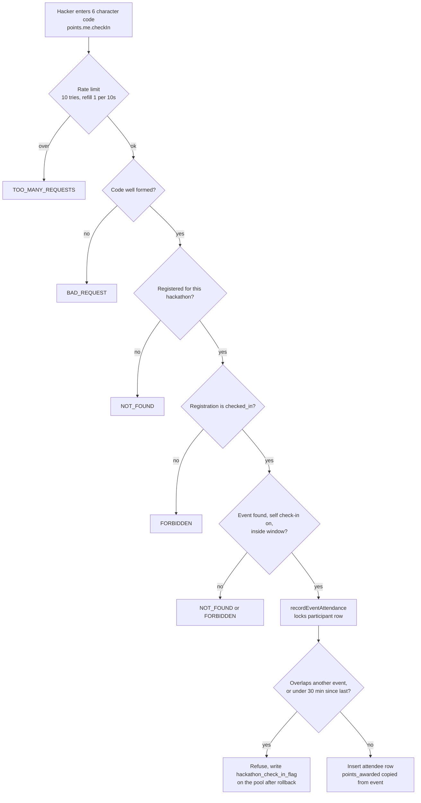

# Hackathon points and the store

Points are a hackathon feature, not a club one. A hacker earns points by checking in to weekend events, staff can add or remove points by hand, and hackers spend them at a physical store table run from the portal. Hackers read their balance and a leaderboard. Door volunteers run sales. Admins build the catalog and void mistakes.

Club event attendance is separate and carries no points: see [Club events](./events.md). Hackathon editions, registration and weekend events are in [Hackathons](./hackathons.md).

## There is no balance column

A balance is always computed from rows that explain it (`packages/db/src/schemas/points.ts`, `services/points.ts`):

```
earned    = sum(hackathon_event_attendee.points_awarded) + sum(hackathon_point_adjustment.delta)
spent     = sum(hackathon_store_purchase.total) where voided_at is null
available = max(0, earned - spent)
```

Undoing a check-in or voiding a sale needs no second write to correct a running total. `readBalance` does this for one person, `balancesFor` for a whole edition in three grouped queries, and `readLedger` returns the rows themselves.

An attendee row copies the event's `points` at the moment of check-in into `points_awarded`, so editing an event later does not rewrite what people earned. Older rows with null count as zero.

## Earning by code

Staff show an event's six character code on a screen. A hacker enters it on their hackathon page (or `/hackathons/[id]/checkin`).



| Rule | Value | Where |
| --- | --- | --- |
| Code alphabet | `ABCDEFGHJKMNPQRSTUVWXYZ23456789` (no 0, 1, I, L, O) | `CHECK_IN_CODE_ALPHABET` |
| Code length | 6. Input is uppercased and spaces and dashes are stripped | `normalizeCheckInCode` |
| Window | Opens 15 minutes before start, closes at end time | `SELF_CHECK_IN_LEAD_MS`, `selfCheckInWindow` |
| Gap between events | 30 minutes | `CHECK_IN_GAP_MS` |
| Who | `notHackathonBanned`, and registration status `checked_in` (badge scanned at the desk) | `points.me.checkIn` |
| Event needs | `selfCheckIn` true and a `checkInCode` | `hackathon_event` columns |

Meals are exempt from the overlap and gap rules, and a meal does not block other events either. The rest of the rule: an event that overlaps one the person already attended in time is refused (`overlap`); any other event within 30 minutes of their last check-in is refused (`too_soon`) with a message that says how many minutes remain. Staff are told to remove the earlier check-in first if it was a mistake.

Codes are issued by staff in `routers/hackathon/events.ts`: `createEvent` and `updateEvent` assign one automatically when `selfCheckIn` is on, `generateEventCheckInCode` and `clearEventCheckInCode` (admin) rotate or remove it, and `getEventCheckInCode` (scanner) reads it. `assignCheckInCode` retries up to 5 times on a collision, since codes are unique per hackathon among non-null values.

### Other ways to be checked in

Staff check people in without a code through the scanner-gated procedures in `routers/hackathon/admin.ts`. `scanParticipantPass` records method `scan`. `admit` and `manualEventCheckIn` record `manual`. All call the same `recordEventAttendance`, so the overlap and gap rules apply to them too. All three refuse an event that has already ended; `manualEventCheckIn`'s message says to credit the person with a points adjustment instead.

A pass scan and `admit` also do the registration-desk job: the first scan moves an `approved` participant to `checked_in` in the same transaction as the attendance row. That status is what later unlocks codes, the store and project submission. Each attendee row stores the `method` and `checked_in_by_id`.

### Rule-break flags

A refused check-in rolls its transaction back, so the attempt is written afterwards, outside it, by `flaggingRuleBreaks` (`services/check-in-flags.ts`). Rows go to `hackathon_check_in_flag`, deduplicated on `(participant, event, conflict event)` with an `attempts` counter. A dismissed flag stays dismissed but keeps counting. Flags are for organisers and judging: they reach staff through `judging.admin.listEntries` and `judging.results.list`, judges see only a boolean, and hackers never see them. Writing the flag is best effort; a failure is logged and the person at the door still gets the normal refusal. Admins clear flags with `judging.admin.dismissCheckInFlag`. See [Judging setup](../judging/setup.md) and [Judging day](../judging/judging-day.md).

## Procedures

`routers/points/` (mounted as `points.admin`, `points.store`, `points.me`).

### Hacker (`points.me`, `routers/points/me.ts`)

All take a `hackathonId`. A hacker must have a participant row, and for reads must be `approved` or `checked_in` ("Points open once your registration is accepted.").

| Procedure | Gate | Returns |
| --- | --- | --- |
| `summary` | protected | `balance`, `checkedIn`, events earned, staff adjustments with reasons, purchases |
| `leaderboard` | protected | Top `limit` (1 to 100, default 10) with the caller's own rank. Names shown as "First L." Only `checked_in` participants rank, ties share a rank |
| `store` | protected | Store status (`catalogVisible`, `open`, `location`) and, when the hacker is checked in and the catalog is visible, items with `soldOut` and `pointsShort` |
| `checkIn` | notHackathonBanned | Redeem an event code. See above |

Staff names and void reasons are not sent to hackers.

### Staff (`points.admin`, `routers/points/admin.ts`)

| Procedure | Gate | Notes |
| --- | --- | --- |
| `adjust` | admin | `delta` from -1000 to 1000, not 0, with a `reason` of 1 to 300 characters that the hacker can see. Row-locks the participant. Audit `points.adjust` (`warn` when negative) |
| `ledger` | admin | Everything behind one person's balance, with who acted |
| `leaderboard` | admin | Full board with full names, email, earned, spent and available |
| `attendance` | admin | Per event: total, by scan, by code, by manual, points paid out. Events with nobody still get a row |

### Store (`points.store`, `routers/points/store.ts`)

| Procedure | Gate | Notes |
| --- | --- | --- |
| `settings` / `updateSettings` | admin | `catalogVisible` and `open` are separate, so the catalog can go up the night before while the table opens later. `location` up to 240 characters |
| `items` | scanner | Catalog. `includeArchived` optional |
| `createItem` / `updateItem` | admin | Name 120, description 2000, price and stock whole numbers up to 100000, display order up to 10000. `stock: null` means not counted, and `soldOut` is then a manual switch. `updateItem` takes the `revision` it opened and returns `CONFLICT` if someone else saved first |
| `deleteItem` | admin | Refused once the item is on any purchase. Archive it instead |
| `searchParticipants` | scanner | Name or email, `approved` and `checked_in` only |
| `lookupParticipant` | scanner | By participant id (the pass QR), with balance |
| `purchase` | scanner | One sale. See below |
| `voidPurchase` | admin | Reason 1 to 300, optional `restock`. Keeps the row, marks it voided, gives the points back. Voiding twice changes nothing. Audit `points.store.voidPurchase` |
| `purchases` | scanner | Sales log, optionally for one participant. Max 100 per page |

### A sale

`purchase` runs in one transaction. It locks the participant row first, then the item, so two stations cannot overspend one balance or sell the last item twice.

- `purchaseId` (a UUID made by the station's browser) is the idempotency key. A retry with the same id and the same buyer, item, quantity and price returns the existing sale with `replayed: true`. The same id for a different sale returns `CONFLICT`.
- The buyer must be `checked_in`.
- `unitPrice` is the price the station showed. If the item changed since, the sale fails with the new price so the buyer sees the new total.
- `quantity` is 1 to 20. Stock is checked with `canSupply`; tracked stock is decremented and the item `revision` bumped.
- `total` must not exceed `available`.
- The purchase row copies the buyer name, item name and prices, so history survives deleted items and renamed people.

## Pages

| Route | What |
| --- | --- |
| `/hackathons/[id]` | Hacker tabs; the points tab is `components/hackathon/points/PointsTab.tsx`, with `CheckInCodeForm.tsx` |
| `/hackathons/[id]/checkin` | Code entry page that event posters link to |
| `/admin/hackathons/[id]` | Admin tab group in `components/admin/hackathons/points/` (`PointsAdminTab`, `StoreTab`, `SaleStation`, `StoreItems`, `StorePurchases`, `StoreSettings`, `PointsLedger`, `ManualCheckIn`, `EventCheckInControls`) |
| `/scan` | Door desk for volunteers |

## Data

| Table | Purpose |
| --- | --- |
| `hackathon_event_attendee` | Check-in per `(event, participant)`, unique. `points_awarded`, `method`, `checked_in_by_id` |
| `hackathon_point_adjustment` | Manual delta with reason and actor |
| `hackathon_store_item` | Catalog: `price`, `stock`, `sold_out`, `archived`, `display_order`, `revision` |
| `hackathon_store_purchase` | Sale: copied names and prices, `stock_tracked`, `voided_at`, `void_reason`, `restocked` |
| `hackathon_check_in_flag` | Refused check-ins for organisers |

Store visibility lives on the edition: `hackathon.store_catalog_visible`, `store_open`, `store_location`.

## Code and tests

| What | Where |
| --- | --- |
| Routers | `packages/api/src/routers/points/` |
| Rules and math | `packages/api/src/services/points.ts` |
| Flags | `packages/api/src/services/check-in-flags.ts` |
| Schema | `packages/db/src/schemas/points.ts`, `hackathons.ts` |
| Tests | `services/points.test.ts`, `services/check-in-flags.test.ts`, `.internal-tests/check-in-flags-desk.test.ts`, `check-in-flags-organizer.test.ts`, `check-in-flags-results.test.ts`, `sites/mainweb/components/admin/hackathons/points/pass.test.ts`, `components/hackathon/points/format.test.ts` |
