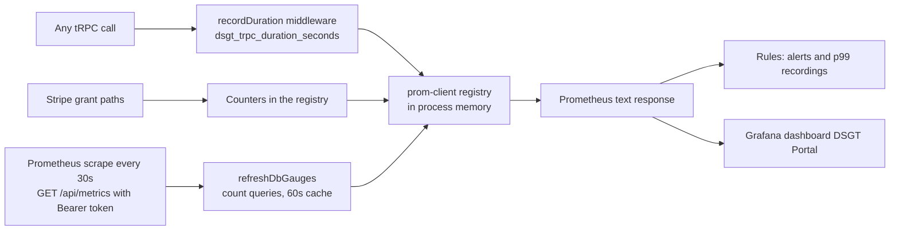

# Status page, metrics and latency

Two things share the word status. The public `/status` page shows uptime and latency recorded from real traffic, for anyone. The Prometheus metrics endpoint, the alert rules and the Grafana dashboard are the deeper view officers and developers use to see whether dues are being granted and whether the API is slow. This page covers both.

Running the monitoring stack locally and scraping production is in the repo's `monitoring/README.md`. Payment-specific counters are explained in [Payments](./payments.md).

## The `/status` page

`/status` shows whether the site is up, how fast it is, and 90 days of uptime history. It is read from Postgres and revalidated every 60 seconds (`export const revalidate = 60`).

### Where the numbers come from

There is no probe and no background worker. Every tRPC procedure is already timed by the `recordDuration` middleware in `packages/api/src/trpc.ts`; the same middleware feeds `packages/api/src/services/status-samples.ts`, which counts each call into an in-process five-minute bucket (requests, server errors, a bounded sample of durations for p50 and p95).

The first call that lands in a later bucket writes the finished bucket to `status_sample` and returns without waiting. The write is an upsert keyed on bucket and instance; a retry replaces the row, so a write that landed but lost its reply is not counted twice. It runs `select 1` and stores whether it answered and how long it took. A failed write is retried with the next flush (up to 12 buckets, then dropped) and counted in `dsgt_status_sample_write_failures_total`. The first flush after a process starts, and then once a day, the same code deletes rows older than 90 days.

Consequences, stated plainly:

- A quiet period has no rows. The page shows it as no data, never as down.
- The newest bucket appears about five minutes late, and an instance that scales down loses the bucket it had open.
- Only tRPC traffic is counted. Pages served without an API call are not.
- A database that is fully down cannot store its own outage. The live check on the page (a `select 1` at render time) and the retried bucket's saved ping cover that.

### Table

`status_sample` (`packages/db/src/schemas/status.ts`), pushed with `drizzle-kit push`. One row per five-minute bucket per instance; primary key `(bucket_start, instance_id)`; `instance_id` is random per process.

| Column             | Meaning                                             |
| ------------------ | --------------------------------------------------- |
| `bucket_start`     | Start of the five-minute bucket, UTC, `timestamptz` |
| `requests`         | tRPC calls in the bucket                            |
| `errors`           | Server errors only                                  |
| `p50_ms`, `p95_ms` | From a bounded in-process sample (500 durations)    |
| `db_ok`, `db_ms`   | `select 1` taken when the bucket was written        |

Aggregates only. No user, route or request detail is stored.

### What counts as an error

Procedures that ended in `INTERNAL_SERVER_ERROR`, `NOT_IMPLEMENTED`, `BAD_GATEWAY`, `SERVICE_UNAVAILABLE` or `GATEWAY_TIMEOUT`. Client errors (`UNAUTHORIZED`, `FORBIDDEN`, `BAD_REQUEST`, `NOT_FOUND`, `TOO_MANY_REQUESTS` and so on) are not downtime and are not counted.

### Uptime rule

Instances are summed per bucket first. A five-minute bucket is **up** when every instance's `db_ok` is true and `errors / requests` is under 5%. Uptime % is up minutes divided by minutes with data. The rule lives in `sites/mainweb/lib/status.ts` and is tested in `lib/status.test.ts`.

### Current status

Derived from the live check and the last 15 minutes of buckets:

- **Down**: the live `select 1` failed, or at least half of the requests in the last 15 minutes were server errors.
- **Degraded**: a bucket in the last 15 minutes broke the uptime rule, or the live ping took over 1 second.
- **Operational**: anything else, including when there is no recent traffic.

### What the page shows

The status headline with the reason, 90 day and 30 day uptime, a 90 day strip with one bar per UTC day (colour by uptime: 99% or better, 95 to 99%, under 95%, gray for no data, with a tooltip and a table view), a 24 hour p95 latency chart (slowest instance per bucket) and a 24 hour requests and errors chart. Times are Eastern. The loader is `sites/mainweb/app/status/load.ts`; each query has a 3 second deadline, and if the database is asleep or stalled the page renders Down with empty charts rather than failing. An open tab refreshes itself every 60 seconds while visible (`AutoRefresh.tsx`).

## Metrics endpoint

`GET /api/metrics`, from `sites/mainweb/app/(portal)/api/metrics/route.ts`. Node runtime, never cached (`force-dynamic`).

| Environment | Auth |
| --- | --- |
| Production | `METRICS_TOKEN` is mandatory. The request must send `Authorization: Bearer <token>`. Without a match, or with no token configured, the route returns **404**, not 401, so it does not advertise itself |
| Development | Open if `METRICS_TOKEN` is unset |

The route calls `refreshDbGauges(db)` and returns `registry.metrics()` as Prometheus text with `cache-control: no-store`. Nothing writes to the database.

## Two kinds of number

Production runs several instances that autoscale and get discarded. That splits the metrics in two. All names are prefixed `dsgt_` (`packages/api/src/services/metrics.ts`).

**Recomputed from the database on each refresh. Correct on any instance.** `refreshDbGauges` runs a handful of `count` queries at most once every 60 seconds per instance (`GAUGE_TTL_MS`), and a failure only increments `dsgt_metrics_refresh_failures_total`.

| Metric | Meaning |
| --- | --- |
| `dsgt_members_active`, `dsgt_members_lapsed` | Paid term not ended, and term ended |
| `dsgt_bootcamp_enrolled{term}` | Members whose `bootcamp_term` is the current term |
| `dsgt_payments_by_plan{plan}` | Paid payments by plan in their metadata |
| `dsgt_payments_unlinked` | Paid, claimed by nobody |
| `dsgt_resumes_stored`, `dsgt_resume_bytes_stored` | Resume book size |
| `dsgt_hackathon_participants{edition,phase,status}` | Registrations per live edition |
| `dsgt_hackathon_projects`, `_checkins_today`, `_judging_projects`, `_votes`, `_judging_active` | Per live edition. Live means status `open`, `closed` or `in_progress`; a finished edition drops out on the next refresh. Check-ins are hackathon badge scans since midnight Eastern, not club door check-ins |

`dsgt_payments_unlinked` is not zero and is not meant to be: most paid rows are people who paid through Stripe and have not signed in since, and the sign-in link claims them when they do. Watch the 24 hour change, not the total.

**In-process counters and histograms. A sample in production.** Each scrape hits one arbitrary instance, and a scale-down throws its numbers away. Read them as "at least this often".

| Metric | Meaning |
| --- | --- |
| `dsgt_payment_intents_total{plan,bootcamp,addon_only}` | Intents minted, by what the server charged |
| `dsgt_membership_grants_total{source,plan}` | Grants by the path that made them |
| `dsgt_membership_grant_failures_total{source}` | A grant threw after the payment was recorded |
| `dsgt_payments_recovered_total` | Charges `reconcileMyPayments` found unrecorded |
| `dsgt_trpc_duration_seconds{procedure,type,ok}` | Histogram of every API call |
| `dsgt_process_*`, `dsgt_nodejs_*` | Default Node metrics: memory, event loop lag, GC |

A local `next dev` is one process, so these are exact there.

## Latency

`recordDuration` in `packages/api/src/trpc.ts` is the outermost middleware on every procedure builder. It times the call and labels it with the procedure path, the type and `ok`. It is outermost on purpose: a request the rate limiter rejects is still a request, and a spike of cheap rejections is what an incident looks like. The path comes from a fixed set, so label cardinality is bounded.

Buckets (seconds): 0.01, 0.05, 0.1, 0.25, 0.5, 0.75, 1, 1.5, 2, 2.5, 5, 10. A p95 or p99 is interpolated inside whichever bucket it lands in, so a threshold with no bucket edge near it is a straight line across a range. Between 5 and 10 seconds the figure is an estimate, not a measurement, and nothing above 10 is reported at all. `services/latency.test.ts` holds three things together: the bucket edges, the quantile arithmetic, and the rules in `monitoring/rules/payments.yml`. It fails if an alerted threshold has no edge, if a rule reads a recording that does not exist, or if a builder or procedure is not timed.

## Alerts

Evaluated by Prometheus from `monitoring/rules/`. There is no Alertmanager in the stack, so nothing routes a firing alert anywhere; someone has to look at Prometheus or the Grafana alert list, or add a receiver.

| Alert | Fires when | Means |
| --- | --- | --- |
| `MembershipGrantFailing` | Any grant failure in 15 minutes | Money taken, membership not granted. `reconcileMyPayments` repairs it on the member's next dashboard load |
| `UnlinkedPaymentsClimbing` | `dsgt_payments_unlinked` up by more than 5 in 24 hours, held 1 hour | Link paths are not claiming payments |
| `ReconcileRecoveringOften` | More than 3 recoveries in an hour | The webhook or the confirm call is dropping payments. Check that `payment_intent.succeeded` is subscribed in Stripe |
| `PortalApiErrorRate` | More than 10% of calls fail for 10 minutes | |
| `PortalApiSlow` | p95 above 2s for 10 minutes | |
| `PortalApiTailSlow` | p99 above 5s for 10 minutes | One call in a hundred is slow. Sort `procedure:dsgt_trpc_duration_seconds:p99` to find which, and compare event loop lag |
| `HackathonJudgingIdle` | Judging on, tables assigned, zero scores, for 30 minutes (`monitoring/rules/hackathon.yml`) | Judges may be blocked from submitting |

Two recording rules, `job:dsgt_trpc_duration_seconds:p99` and `procedure:dsgt_trpc_duration_seconds:p99`, exist because `histogram_quantile` over a 5 minute rate is the most expensive expression on the dashboard.

## Admin analytics (inside the portal)

`/admin/analytics` does not need Prometheus. It uses three admin procedures, each behind a short cache so open tabs do not multiply the load. `analyticsOverview` and `hackathonLive` poll every 15 seconds; `growth` is fetched once:

| Procedure | Shows | Cache |
| --- | --- | --- |
| `admin.analyticsOverview` | Participants, club events, live hackathons, today's badge scans and door check-ins | 15s |
| `admin.hackathonLive` | The same counts as the hackathon gauges, from `readLiveHackathons` | 15s |
| `admin.growth` | Members per month for 12 months and bootcamp enrolment per term | 300s |

See [Admin tools](./admin.md).

## Adding a metric

1. Counters and histograms: create them in `services/metrics.ts` with `registers: [registry]` and increment where the thing happens. Remember they are a sample in production.
2. Anything that must be right in production: make it a gauge set inside `refreshDbGauges`, from a count query. Keep the query read-only and cheap; the database is a 0.5 GB Neon instance.
3. If you alert on it, add the rule under `monitoring/rules/` and, for latency, make sure a bucket edge sits on the threshold. The tests will say if not.
4. Edit the dashboard in `monitoring/grafana/dashboards/dsgt-portal.json`. Changes made in the Grafana UI are overwritten.

## Code and tests

| What | Where |
| --- | --- |
| Registry, counters, gauges | `packages/api/src/services/metrics.ts` |
| Timing middleware | `packages/api/src/trpc.ts` (`recordDuration`) |
| Endpoint | `sites/mainweb/app/(portal)/api/metrics/route.ts` |
| Status page | `sites/mainweb/app/status/` (`page.tsx`, `load.ts`, `AutoRefresh.tsx`), rules in `sites/mainweb/lib/status.ts` |
| Status samples | `packages/api/src/services/status-samples.ts`, table `packages/db/src/schemas/status.ts` |
| Stack and rules | `monitoring/` (`prometheus.yml`, `rules/payments.yml`, `rules/hackathon.yml`, `grafana/dashboards/dsgt-portal.json`, `README.md`) |
| Tests | `services/latency.test.ts`, `services/hackathon-metrics.test.ts`, `services/status-samples.test.ts`, `lib/status.test.ts`, `app/status/load.test.ts` |
