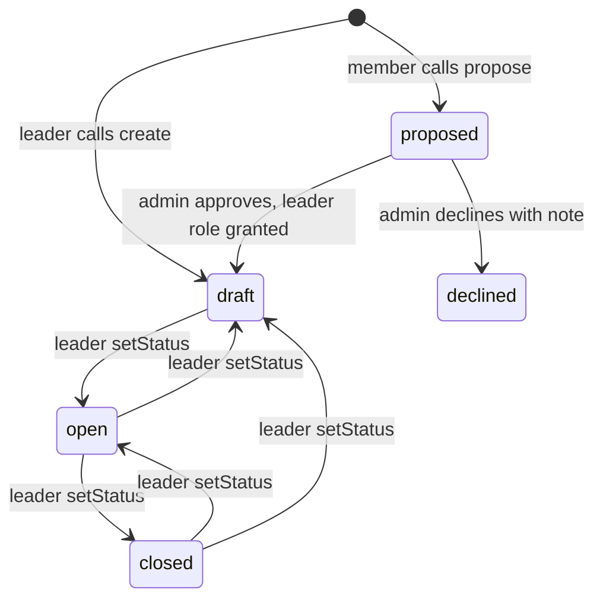

# Teams, subteams and club projects

Four different "team" ideas live in the site. They share a word and almost nothing else.

| Name | What | Who | Router | Page |
| --- | --- | --- | --- | --- |
| Executive board | The officers listed on the public site | Visitors | none, hardcoded | `/team` |
| Subteams | Standing groups that run the club (events, marketing, tech), joined by application | Members, admins | `subteam` | `/subteams`, `/admin/subteams` |
| Club projects (initiatives) | Year-round projects a leader runs and members apply to join | Members, project leaders, admins | `initiative` | `/initiatives`, `/lead`, `/admin/initiatives`, public `/projects` |
| Hackathon teams | 2 to 4 hackers building one project at a hackathon, and the project they submit | Hackers | `team` | Hackathon page, `/submit` |

`/team` is a static page in `sites/mainweb/app/team/page.tsx`. Names, titles and photos are written into the file, so changing the board is a code edit.

Applying to a subteam or initiative needs an active membership ([Membership](./membership.md)). Hackathon teams do not. A subteam is staff-run with no leader and no seat cap. An initiative has a leader and an optional cap. The two are separate tables on purpose.

## Subteams

An admin creates a subteam with a name, a summary (300), a description (4000) and up to 10 questions (prompt up to 300, required or not). It starts closed. A member applies with an answer to each question and an optional note. An admin accepts or rejects.

| Status | Meaning |
| --- | --- |
| `pending` | Applied, undecided |
| `accepted` | On the subteam |
| `rejected` | Turned down |
| `withdrawn` | Applicant took it back (only while pending) |
| `removed` | Accepted member taken off the roster by an admin |

A new row is written per application, never reused, so the history of apply, reject, apply again is kept. A partial unique index (`subteam_application_active_idx`) allows one `pending` or `accepted` application per member per subteam.

Rules in `routers/subteam.ts`:

- `requestToJoin` locks the subteam row before reading, so an admin closing or archiving mid-submit is seen. It needs an unarchived subteam (else it answers `NOT_FOUND`), an active membership, the subteam to be open, and a non-empty answer to every required question. Answers are matched to the questions as they are now and the prompt text is copied into each answer, so later question edits do not scramble old answers. Answers max 2000 characters, note 1000.
- `decide` accepts a note up to 1000 that the applicant sees. It only acts on `pending` rows, with the status in the `WHERE`, so two admins deciding at once produce one decision and one email.
- Archiving a subteam also closes it. Decisions on an archived subteam are refused until it is restored.
- Emails (received, accepted, rejected) go out after the write and never inside it. A failed send is logged and the decision stands.

| Procedure | Gate |
| --- | --- |
| `list` | protected (any signed-in user sees open, unarchived subteams, max 60, with their own status) |
| `myApplications`, `requestToJoin`, `withdraw` | protected (`requestToJoin` checks membership inside) |
| `adminList`, `create`, `update`, `setArchived`, `applicants`, `roster`, `decide`, `removeMember` | admin |

`applicants` returns up to 500 rows with per-status counts, optionally filtered. Tables: `subteam`, `subteam_application` (`packages/db/src/schemas/subteams.ts`). Questions and answers are jsonb on the rows.

## Club projects (initiatives)

An initiative is a project members can apply to join. It has a leader (a `project_leader`, who is a member with a standing appointment and not staff), a status, an optional cap and a queue of applications.

A leader moves an initiative freely among `draft`, `open` and `closed` with `setStatus`, except that `proposed` and `declined` are not theirs to change. Only `open`, unarchived initiatives are visible to members. When someone applies, an archived, `draft`, `proposed` or `declined` initiative answers `NOT_FOUND` like an unknown id, so a pitch is never leaked. A `closed`, unarchived one answers `BAD_REQUEST`, "This project is not taking applications."

### Applying

`requestToJoin` (upload gate, 2MB payload cap) takes a pitch of 1 to 1000 characters and an optional PDF resume.

- The resume is a data URL, PDF only, up to 2MB, with the `%PDF-` signature checked. It is stored in `initiative_application.resume_data` and is never selected by the queue query. It is read only by `applicantResume`. Omitting a resume on a re-apply keeps the one on file. This is separate from the [resume book](../resume-book.md), which has its own storage.
- The initiative row is locked first. Applicants need an active membership, an `open` initiative, and must not already lead it.
- The cap is checked at both apply time and decision time (`acceptedSeats`). `maxMembers` counts accepted members only, not the leader, so a team of four is leader plus three. A new initiative defaults to 3 when none is given; `null` means uncapped.
- Re-applying after `withdrawn` reuses the same row (unique on initiative and user) and clears the old decision.
- `decide` (leader) locks the initiative, refuses a withdrawn application, treats the same decision twice as a no-op, and sends one email after commit.

### Proposals

Any active member can `propose` an initiative. It is created with status `proposed` and the proposer as leader. At most three proposals may be waiting per person. An admin runs `reviewProposal`: approve moves it to `draft`, creates or reactivates the proposer's `project_leader` row and evicts the leader caches; decline sets `declined` with an optional note. The proposer gets an email either way.

### Procedures (`routers/initiative.ts`)

| Procedure | Gate | Notes |
| --- | --- | --- |
| `listMine`, `getById`, `update`, `setStatus`, `setArchived`, `applicantResume`, `decide` | project leader | Leader sees only their own; staff pass the gate and may manage any (`canManage`). A project that is not theirs answers `NOT_FOUND`, not `FORBIDDEN` |
| `create` | project leader | A leader creates for themselves. Staff must name `leaderUserId`, who must be an active leader, or the call fails, so an admin is never recorded as the leader by default |
| `list`, `myApplications`, `requestToJoin`, `withdraw`, `propose`, `myProposals`, `withdrawProposal` | protected | Membership is checked inside `requestToJoin` and `propose` |
| `listProposals`, `reviewProposal`, `listLeaders` | admin | `listLeaders` is capped at 200 |
| `setLeader` | super admin | Grant or revoke. The row is kept (`isActive`) so the appointment stays on record |

The `isProjectLeader` gate (`middleware/procedures.ts`) passes an active leader or full staff. Staff passing it is not the reverse: a leader does not pass `isAdmin`. Bug testers do not count as staff here. Leader checks cache for 60 seconds; grants clear those keys and the portal context.

### The public roster

`/` and `/projects` read the `club_project` table, not the initiative table, and are separate so a card can exist with no leader or seats. Setup and the seed command are in the [club project overview](../club-project.md). Statuses are `active`, `revived`, `needs_lead`, `past`. A card links to the portal only when `initiative_id` is set; otherwise it uses `join_url`. Read in `sites/mainweb/lib/club-projects.server.ts`, revalidated every 300 seconds, not through tRPC.

## Hackathon teams and submission

`routers/team.ts`, for hackers at an edition. Details of registration and edition setup are in [Hackathons](./hackathons.md); how submitted projects are judged is in [Judging](../judging/README.md).

| Procedure | Gate | Rule |
| --- | --- | --- |
| `createTeam` | notHackathonBanned | Name up to 100, description 500, size 2 to 4 (default 4). Caller must be registered and `approved` or `checked_in`, not already on a team, and have no live solo submission. Caller becomes captain |
| `joinTeam` | notHackathonBanned | Team must be open and not full. Slot claim and seat count are guarded, so racing joins lose cleanly |
| `leaveTeam` | protected | Not after the roster lock. A captain with other members cannot leave. A sole captain leaving disbands the team, which is refused while a project is submitted |
| `disbandTeam` | protected | Captain only, same lock, refused while a project is submitted |
| `setOpen` | protected | Captain only |
| `list` | protected | All teams of a visible edition with captain and members. Cached 5 seconds (`VOLATILE_TTL`). Not paginated, on purpose, so a hacker's own team is always in the list |
| `window`, `submissionWindow` | protected | The timetable below, so pages and procedures agree |
| `submitProject` | notHackathonBanned | Caller must be `checked_in`. Team captain submits for the team; a solo hacker submits alone. Name 120, description 10 to 5000, up to 30 technologies, 20 tracks, 20 challenges, optional GitHub, demo and video URLs. Tracks and challenges not offered by the edition are dropped silently |
| `withdrawProject` | protected | Captain only on a team. Sets the project back to `draft`. Refused once judging has the project |
| `mySubmission`, `myProjects` | protected | The caller's own project(s), with `inJudging` |

Timetable, measured from `hackingStartTime` (or `startDate` if unset), in `computeTeamWindow` and `computeSubmissionWindow`:

| Moment | Offset |
| --- | --- |
| Teams may form from | any time, until +34h |
| Submission opens | +12h |
| Roster locks (no leave or disband) | +24h |
| Edits to an existing submission close, team editing closes | +34h |
| Hard deadline, new submissions and withdrawals | +36h |

A resubmit is an edit of the same row. Status only moves forward: a project already in `judging` or `winner` keeps that status when edited. A project an organiser withdrew, in the admin projects screen or from judging, cannot be resubmitted. A project is also what judging later turns into an entry; see [Judging setup](../judging/setup.md).

## Pages

| Route | What |
| --- | --- |
| `/subteams` | Members browse, apply, withdraw |
| `/initiatives` | Members browse open projects, apply with pitch and resume, propose |
| `/lead`, `/lead/[id]` | Leaders manage their projects and applicants |
| `/admin/subteams` | Staff manage subteams, questions, applicants, roster |
| `/admin/initiatives` | Staff review proposals and appoint leaders |
| `/admin/projects` | Staff view and withdraw hackathon submissions |
| `/submit` | Hackers file the hackathon project |

## Code and tests

| What | Where |
| --- | --- |
| Routers | `packages/api/src/routers/subteam.ts`, `initiative.ts`, `team.ts` |
| Schema | `packages/db/src/schemas/subteams.ts`, `initiatives.ts`, `club-projects.ts`, `hackathons.ts` |
| Tests | `.internal-tests/subteam.test.ts`, `initiative-edge.test.ts`, `hackathon-flow.test.ts`, `participant-edge.test.ts` |
