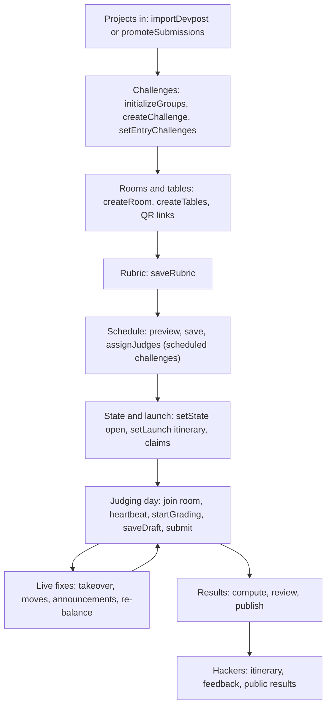

# Hackathon judging

Room-based project judging for a hackathon edition. Organisers bring projects in, sort them into prize challenges, set up rooms and a schedule, and open judging. Judges grade at a phone-friendly desk on the day, and organisers compute, review and publish the results. Hackers look up where and when they present and read the feedback they were given.

The code is one tRPC router, `judging`, with five sub-routers (`packages/api/src/routers/judging/index.ts`), plus pure services under `packages/api/src/services/judging/`. Every table is prefixed `judging_`. Most carry a `hackathon_id`; `judging_evaluation_rating`, `judging_evaluation_response`, `judging_evaluation_revision`, `judging_deliberation_section` and `judging_deliberation_entry` have none and hang off an evaluation, a judge or a section (`packages/db/src/schemas/judging.ts`).

## Pages in this section

| Page | What it covers |
| --- | --- |
| [Setup](./setup.md) | Config and state, Devpost import, challenges, rooms and tables, QR links, judges, rubric, launch checklist |
| [Judging day](./judging-day.md) | The judge desk, presence, appointment status, takeover, grading hold, leaving a room, announcements, hacker itinerary |
| [Scoring and results](./scoring-and-results.md) | Evaluations, scoring, calibration, the judge's private shortlist, placements, publishing, reopening a grade |
| [Scheduler](./scheduler.md) | How room presentations are placed on a timetable and judges assigned to them |
| [Repo check](./repo-check.md) | Flagging projects pushed to on GitHub after the submission deadline, and the organiser decisions |
| [Adaptive features](./adaptive.md) | Setup advice, suggested timing, archiving rooms, live re-balance of judges |
| [Simulations](./simulations.md) | Load simulations and what they found |

## Two judging styles

A challenge has a `mode` (`judging_challenge.mode`). A child challenge is judged the way its root is (`effectiveMode` in `services/judging/scope.ts`), and rooms serve a root challenge or group.

| Mode | How it is judged | Who sees it |
| --- | --- | --- |
| `scheduled` | Timed presentations. Each project gets an appointment (`judging_appointment`) in a room or table at a time, with a deadline. Once a schedule is saved, the judge must be seated in a room that serves the challenge. | Hackers see room and time on their itinerary. |
| `unscheduled` | Judged in rooms, untimed. No appointments. A judge is offered a short window of open projects in their own shuffled order (the queue). | Hackers see the challenge but no time. |
| `remote` | Untimed and judged without the team present. | Hidden from hackers. |

The two behaviours that differ in code:

- **Timed (scheduled).** `evaluationTiming` in `services/judging/timing.ts` checks the judge is seated in a room for the challenge, the presentation has started, and the deadline has not passed. A draft still open at the deadline is submitted for the judge. These checks apply only once a schedule is saved; before that, a `scheduled` challenge is untimed and is judged from the queue with no seat check.
- **Queue (unscheduled, remote).** `queueWindow` in `services/judging/queue.ts` hashes `judgeId:entryId:challengeId`, so each judge walks the same projects in a different but stable order. Only the first `QUEUE_WINDOW` (3) open projects are offered, so a judge can skip a team that is away but cannot pick projects. Random samples are what make [calibration](./scoring-and-results.md#calibration) valid for queue-judged challenges. Scheduled challenges, including the default General, are graded by the judges the deterministic assigner picks (greedy plus local search, with a preference to stay in one room), not by a hashed sample; calibration still runs on those grades.

The default for a new challenge is `scheduled`. The starter groups made by `initializeGroups` are "General" (scheduled, every project belongs) and "MLH Challenges" (unscheduled, collects imported labels containing "MLH").

## Who does what

| Role | How they get in | What they do |
| --- | --- | --- |
| Organiser | Staff admin, `isAdmin` procedures under `/admin/judging` | Everything in setup, the live board, announcements, results |
| Member judge | Signed-in portal user with an approved, active `judge` row for the edition, or any active staff admin. A `judging_judge` row of kind `member` is made on first desk visit. | Joins any open room, grades untimed general challenges anywhere (a scheduled one needs a seat in a room serving it once a schedule is saved) and a sponsor challenge only from a seat in its room, keeps a private shortlist |
| Guest judge | Scans a room's QR code with no judge account. A cookie session (8 hours) is created, and typing a name makes a `judging_judge` row of kind `guest`. | Locked to that room's challenge and what sits under it. Cannot move rooms. |
| Hacker | Checked-in portal user who holds a place on a project (claimed by email, claim link, or portal submission) | Looks up their itinerary, reads shared feedback and public results |

Judge accounts, applications and approval live in the judge portal feature, see [judge-portal](../features/judge-portal.md). Hackathon records, registration and check-in are in [hackathons](../features/hackathons.md).

## Lifecycle

The order is a checklist, not a hard gate. `judging.admin.checklist` reports seven items in this order: projects, rubric and groups, rooms, schedule, judging open, claims, itinerary. Some steps lock others, which is the real ordering:

- The first room link or first claim sets `inventoryLockedAt`. From then on a Devpost import only adds projects.
- A saved schedule or any evaluation or draft freezes the challenge tree (grouping, mode, general flag).
- Opening judging fixes the rubric. It can go back to draft only while no evaluation or draft exists.
- The first submitted evaluation tied to an appointment stamps `firstResultAt` on the schedule, after which the schedule cannot be dropped. Queue evaluations do not stamp it, and dropping evaluations clears it again.

## Data

| Table | Holds |
| --- | --- |
| `judging_config` | One row per edition: state, switches (`showAllScores`, `itineraryPublished`, `emergencyMode`, `autoRebalance`, `repoCheckEnabled` and its grace), lock timestamps |
| `judging_entry`, `judging_entry_member`, `judging_claim_link` | Projects, their teammates, one-time claim links |
| `judging_challenge`, `judging_entry_challenge` | The challenge tree and which projects are in which challenge |
| `judging_building`, `judging_room`, `judging_room_link`, `judging_guest_session` | Halls, rooms and tables, QR links, guest cookie sessions |
| `judging_judge`, `judging_presence` | Judge identities and which room each sits in |
| `judging_schedule`, `judging_appointment` | The saved timetable and its presentations |
| `judging_rubric_item`, `judging_evaluation`, `judging_evaluation_draft`, `judging_evaluation_rating`, `judging_evaluation_response`, `judging_evaluation_revision` | The rubric and judges' answers |
| `judging_deliberation_section`, `judging_deliberation_entry` | A judge's private shortlist |
| `judging_placement` | Computed and published placings |
| `judging_repo_check` | Per project: GitHub last-push check against the submission deadline and the organiser decision, see [repo check](./repo-check.md) |
| `judging_announcement` | The pinned message for all judges or one room |

The older `judging_project`, `judge_vote`, `judge_queue` and `hackathon_result` tables are retired and kept for past editions. `hackathon.getResults` still merges their published rows with new placements.

## Where the code lives

| Piece | Path |
| --- | --- |
| Routers | `packages/api/src/routers/judging/` (`admin`, `schedule`, `desk`, `hacker`, `results`) |
| Services and tests | `packages/api/src/services/judging/` (each `*.ts` has a `*.test.ts`) |
| Scheduler | `packages/api/src/services/judging/schedule/` |
| Schema | `packages/db/src/schemas/judging.ts` |
| Organiser console | `sites/mainweb/app/(portal)/admin/judging/[hackathonId]/page.tsx`, sections in `sites/mainweb/components/admin/judging/` |
| Room QR print sheet | `sites/mainweb/app/(portal)/admin/judging/[hackathonId]/qr/page.tsx` |
| Judge desk | `sites/mainweb/app/(portal)/judge/`, components in `sites/mainweb/components/judge/` |
| QR landing route | `sites/mainweb/app/(portal)/judge/activate/[linkId]/route.ts` |
| Hacker tab | `sites/mainweb/components/hackathon/judging/` |

For the whole-system picture see [architecture](../architecture.md) and the API package page [packages/api](../packages/api.md).
