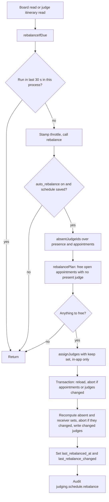

# Adaptive judging features

Four features let the scheduler react to the real event instead of asking the organiser to do arithmetic: setup advice, auto-sized rooms, a suggested timing, and live re-balance of judges. Organisers meet the first three while planning in the Schedule tab, and the fourth runs on its own during judging.

Background is in [scheduler.md](./scheduler.md): the slot model, the solver, `MAX_CONSECUTIVE` and seat capacity. Measured results for these features are in [simulations.md](./simulations.md).

## 1. Setup advice

`adviceFor` in `packages/api/src/services/judging/schedule/advice.ts` looks at a solved preview and says, in plain words, what the organiser could change. It is pure: the router (`adviceOf` in `schedule.ts`) reads the edition, `adviceFor` only counts. `preview` returns it as `advice`, also when the solve failed. At most `MAX_ADVICE` (4) items come back, in the order below, so the later kinds are the first cut when four fire.

| Kind | Fires when | Button |
| --- | --- | --- |
| `window` | The solve failed on capacity or overload and the fewest slots the plan needs (`slotsNeeded`) exceeds the window. Says how many minutes the window must be (`needed x slot length`). | none |
| `judges` | The solve worked, but `judgeShortfalls` finds presentations no judge can cover. Says how many have no judge and about how many more table judges would cover them. If no table judge may grade a challenge, it says to check judge permissions instead. | none |
| `moreTables` | One general challenge decides the end (it finishes after every sponsor and past 80% of the window, `TIGHT` = 0.8), or it did not fit and has rooms. The judges must have spare seats. | `addTables` |
| `sponsorRoom` | Sponsor challenges decide when judging ends and one more room each would end it at least one slot sooner. | `addRooms` |
| `unusedTables` | Tables exist that the schedule is not using because the judges cannot staff them (see section 2). | `archiveTables` |

How the numbers come out:

- **`judges`**: the count of extra judges is `max(1, ceil(busiest x (MAX_CONSECUTIVE + 1) / MAX_CONSECUTIVE) - members)`, where `busiest` is the most presentations in any one slot in rooms without a guest judge.
- **`moreTables`**: `spareSeats = seats - unstaffed rooms` (seats from the capacity formula in scheduler.md). The tables to add are `min(spareSeats, want - have)`, where `want = ceil(presentations / floor(slots x 0.8))`. The button creates them in the building of an existing table of that challenge.
- **`sponsorRoom`**: for the sponsor challenges that finish in the last slot, it estimates the new end as the larger of the general floor, the other sponsors' current finish, and `ceil(presentations / (rooms + 1))` for the tied ones. If that saves at least one slot, the message says how many minutes (`saved x slot minutes`). If the new rooms exceed the seats, it adds that the day would also need more judges.

### Sponsor ties

Often several sponsor challenges finish in the same last slot. Adding a room for only one of them would not end the day sooner, so the advice treats the tied set as one change:

- The message names them: "A decides", "A and B decide", "A, B and C decide", or "5 sponsors decide" past four names. It says one more room "each" for more than one.
- The action is one `addRooms` entry per tied sponsor, in a building where that sponsor already has a room.
- Names follow the sponsor's existing rooms: the highest trailing number is incremented ("Room 2" becomes "Room 3"), skipping any name already used in that building, compared case-insensitively. A sponsor whose rooms carry no number gets "<label> N".
- Time saved is limited by the slowest of the rest, since the day only ends as soon as the last unaided challenge does.

### The buttons

`PlanAdvice.tsx` renders each advice item with a button when it has an action. After any change it calls `onChanged`, and `SchedulePlanner` invalidates the admin queries and refetches `preview`, so the organiser sees the new schedule.

| Action | What it calls |
| --- | --- |
| `archiveTables` (`roomIds`) | `judging.admin.archiveRooms` |
| `addTables` (`challengeId`, `buildingId`, `count`) | `judging.admin.createTables` |
| `addRooms` (a list of challenge, building, name) | `judging.admin.createRoom` once per room, in order, with kind `room`. It stops at the first failure, and rooms already added still trigger a new preview. |

Buttons are disabled in read-only portal mode.

## 2. Auto-sized rooms

The organiser can enter every table they have. The scheduler does not use them all: `roomsJudgesCanStaff` leaves out the tables the judges cannot sit at once (60 member judges give 48 seats, so about 15 of 63 tables are left out; the full math is in [scheduler.md](./scheduler.md#seat-capacity)). `solveInventory` retries with up to 3 more tables dropped when staffing every seat still leaves presentations with no judge. The preview shows `roomsLeftOut`.

Left-out tables are not archived automatically; they still exist and still show in the room list. That is what the `unusedTables` advice is for, and its button runs the archive flow:

1. `judging.admin.archiveRooms` takes the room ids (1 to 500) and runs in one transaction under the edition lock.
2. It loads the rooms and fails with "not found" if any id is missing or belongs to another hackathon.
3. For each room that is not already archived (`archiveLockedRoom`): refuse if any presentation is scheduled in it; revoke the room's guest access and sign guests out; stand up everyone still seated (`emptyRoom` sets `left_at` on open presence rows); clear its open announcements; set `archived_at`.
4. All or nothing: one room that has presentations scheduled, or belongs to another edition, refuses the whole batch.
5. After the transaction it writes one `judging.archiveRoom` audit entry per room (severity `warn`, with `guestsSignedOut`), and returns `{ archived }`.

`selectPlan` drops archived rooms from the plan, so the next preview gives the same schedule without them. The admin room list (`admin.listRooms`) still returns archived rooms; only the judge desk's room list hides them. Because only tables with no appointments can be archived, this is a pre-schedule step; once a schedule is saved, rooms with appointments have to be emptied first.

## 3. Smart defaults: `suggestTiming`

The planner opens with a window already filled in. `schedule.suggestTiming` (admin, query) returns it, and returns null when nothing is entered yet or a schedule is already saved.

How it sizes the window:

1. The start is the next quarter hour at least 15 minutes from now.
2. Slot length uses the form defaults: 2 setup, 6 judging, 2 teardown (10 minutes), with 10 and 20 minute breaks (`DEFAULT_MINUTES`).
3. `lowest = slotsNeeded(...)`: the larger of the busiest challenge's presentations divided by its rooms (rounded up) and the longest chain of one project's presentations with same-building breaks between them.
4. Start at `ceil(lowest x 1.2)` slots (capped at `MAX_SLOTS`), solve with the real judge roster, and if that fails, grow by 1.25x and retry, at most 4 more times.
5. The result has `timing`, a `basis` (projects, presentations, rooms, member judges) and `spareMinutes = (slots - score finish) x slot minutes`: how much of the window the solved schedule does not use.

The planner fills the window once when the suggestion arrives and the fields are empty (`SchedulePlanner.tsx`), and never overwrites what the organiser typed. The suggestion always uses the default minutes, not whatever is in the form.

If all five sizes fail, `suggestTiming` still returns the last and largest window, with `spareMinutes` of 0. A suggestion therefore does not prove the schedule fits; check the preview.

## 4. Live re-balance

During judging, judges walk out, phones lock and people do not show up. Re-balance moves the presentations of absent judges to receivers (guests, and members who are here; see [Who can receive work](#who-can-receive-work)), without touching time or room, and without moving anyone else's work.

### There is no background worker

Nothing runs on a timer. `rebalanceIfDue(db, hackathonId, now)` in `schedule.ts` is called lazily from two reads:

- `judging.schedule.get`, the organiser's live board (polled while judging runs).
- `judging.desk.itinerary`, a judge's own list of upcoming presentations.

It is throttled by an in-memory map, `rebalanceThrottle`, keyed by hackathon: if it last ran less than `REBALANCE_EVERY_MS` (30,000) ago in this process, it returns at once. The stamp is set before the work starts, so a run that finds nothing to do or fails still holds the throttle for 30 seconds. The map is per server process, so several instances each throttle on their own. The real delay between a judge leaving and presentations moving is the absence threshold (`LEFT_GRACE_MS`, 5 minutes after leaving, or `QUIET_AFTER_MS`, 10 minutes after the last heartbeat), plus up to 30 seconds of throttle, plus the time until the next read arrives. The function never throws; a failure is logged and the next read tries again. If nobody reads the board and no judge opens an itinerary, nothing re-balances.

### Who counts as absent

`absentJudgeIds` in `rebalance.ts` decides, from presence rows and appointments. Only member judges can be absent; guests are pinned to their room and always count as here. A guest whose 8-hour session has lapsed is no longer on the roster: `readRoster` keeps only guest sessions that are not revoked and have `expiresAt` in the future, so they neither hold nor receive work. A member is absent when any of these holds:

| Rule | Condition | Constant |
| --- | --- | --- |
| Left | They have presence rows, all closed (`left_at` set), and the latest `left_at` is more than 5 minutes ago | `LEFT_GRACE_MS` = 5 min |
| Went quiet | They have an open presence row whose newest heartbeat (`last_seen_at`) is more than 10 minutes old | `QUIET_AFTER_MS` = 10 min |
| Missed one | An appointment of theirs has status `missed`, and they have no presence at all, or were last seen before it began | none |
| Never seen | No presence rows, judging is under way (some appointment of the edition has started), and an open presentation of theirs starts within 10 minutes | 10 min, a private `LATE_WITHIN_MS` |

The left grace is long enough to walk to another room and join it: moving between rooms closes one presence row and opens another, and an open row counts as here. The quiet limit is longer than a presentation because phones lock between presentations and stop the heartbeat, and a judge rests one slot after four in a row.

The heartbeat is a query in `use-heartbeat.ts` with `refetchInterval: 60_000` and `refetchIntervalInBackground: true`, so it keeps beating while the desk tab is hidden; a judge reading another tab is still in the room. React Query's refetch on window focus is off. Instead the hook beats again on `visibilitychange` (when the tab becomes visible) and on window `focus`. A locked phone still stops the heartbeat, which is why the quiet limit is longer than a presentation.

### Who can receive work

Being here is not enough to be given new work. Freed presentations go only to receivers (`receiverIds` in `rebalance.ts`):

- guests, who are pinned to their room;
- members who are not absent and either have an open presence row or were seen within `QUIET_AFTER_MS` (the later of `joined_at` and `last_seen_at`).

A member inside the 5-minute leave grace who was seen in the last 10 minutes is still a receiver. A member who was never seen is not absent until `LATE_WITHIN_MS`, but is not a receiver either: they keep the presentations they hold and are given nothing new. Absent judges lose their open presentations; non-receivers keep theirs.

### What moves

`rebalancePlan` takes the saved appointments that are `open` (not started, nothing evaluated or drafted) and not removed, and splits them:

- **free**: no judge, or a judge who is absent. These are given again.
- **keep**: open appointments whose judge is here. They stay and count toward each judge's load and breaks.

Appointments that are not open keep their judge as well. `assignJudges` then runs with the absent judges removed from the roster, the members who are not receivers left on it but unable to grade anything (so their open work lands in `keep`), and `keep` set, the same in-app assigner described in scheduler.md. Re-balance never calls CP-SAT, because it runs on reads and has to be quick. The write changes only `assigned_judge_id`: never a room or a time.

Safety:

- The board is read, the plan made, then the board is read again inside a transaction with the schedule row locked. If the saved appointments or the roster changed in between (`staleJudging`), the run does nothing and the next read tries again.
- Under the same lock the absent and receiver sets are recomputed (`stalePresence`). If anyone moved in or out of either set between the two reads, the run also gives up quietly, with no write and no audit entry.
- If the plan changes no judge, nothing is written.
- Writes are one update per receiving judge (`applyJudgeChanges`), in chunks of 1000. Presentations freed when nobody is free form one more group and are written as unassigned (`assigned_judge_id` null).

### Switch and record

| What | Where |
| --- | --- |
| `auto_rebalance` (default true) | `judging_config`. Off means `rebalance` returns before reading anything. Turned on or off with `judging.schedule.setAutoRebalance`, audited as `judging.schedule.setAutoRebalance`. |
| `last_rebalanced_at`, `last_rebalance_changed` | `judging_schedule`. Set in the same transaction as the move. |
| Audit action `judging.schedule.rebalance` | Written after the transaction with no user (`userId: null`) and metadata `{ changed, kept }`. |

`JudgesPanel.tsx` shows the "Re-balance automatically" checkbox with the rule text ("When a judge leaves for 5 minutes, goes quiet for 10, or misses a presentation..."), and a line "Last re-balanced <time>: N presentations moved" when `last_rebalance_changed` is above zero. N is the number of changed presentations, which includes presentations that lost their judge and got none, so it is not only moves. The "Assign judges" button beside it is the manual version: it re-picks every not-yet-started presentation, uses CP-SAT when the server has it, and audits `judging.schedule.assignJudges`. It respects presence once judging is under way (`hereOf` in `schedule.ts`): judging is under way once the earliest open appointment is within `LATE_WITHIN_MS` (10 minutes) of starting. From then `withoutAbsent` removes absent members from the roster and only receivers keep their challenges, so absent and never-arrived members are given nothing new. Before judging is under way nobody has checked in, so every judge on the roster may be assigned. The write is refused with `CONFLICT` if the absent or receiver sets changed while it ran.

### Limits

- A returning judge is not given their presentations back. Moved work stays with the new judge until someone runs "Assign judges" (which ignores presence, see above) or edits it by hand.
- Re-balance only changes who judges a presentation. A presentation with no judge when no present judge is free stays unjudged; it is not moved to a later slot where a judge is free. That is a known follow-up (see [simulations.md](./simulations.md)).
- Timing depends on reads (above), so a quiet board delays it.

## Where the code and tests live

| Piece | Path |
| --- | --- |
| Advice | `packages/api/src/services/judging/schedule/advice.ts` (`advice.test.ts`) |
| Absent judges, plan | `packages/api/src/services/judging/schedule/rebalance.ts` (`rebalance.test.ts`) |
| Router: `preview`, `suggestTiming`, `rebalanceIfDue`, `setAutoRebalance`, `assignJudges` | `packages/api/src/routers/judging/schedule.ts` |
| Router: `archiveRooms`, `createTables`, `createRoom` | `packages/api/src/routers/judging/admin.ts` |
| Columns | `packages/db/src/schemas/judging.ts` (`judging_config.auto_rebalance`, `judging_schedule.last_rebalanced_at`, `last_rebalance_changed`) |
| UI | `sites/mainweb/components/admin/judging/schedule/PlanAdvice.tsx`, `SchedulePlanner.tsx`, `JudgesPanel.tsx` |
| Router tests | `packages/api/src/.internal-tests/schedule-judges.test.ts` ("preview: advice", "suggestTiming", "re-balancing judges on their own"), `packages/api/src/.internal-tests/archive-rooms.test.ts` |
