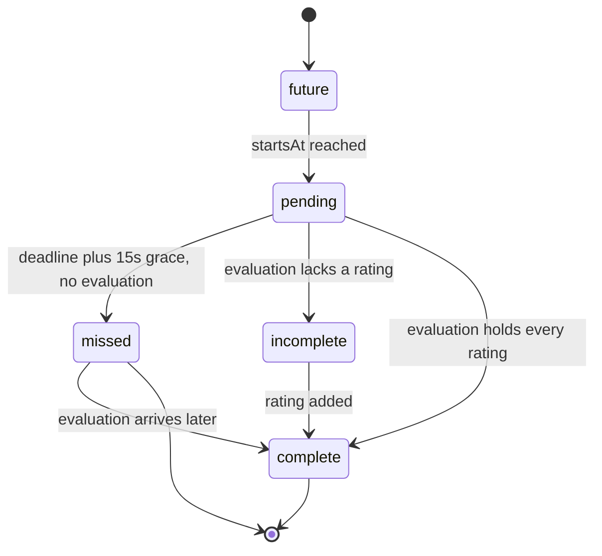

# Judging day

What happens once judging is open: judges sit in rooms and grade from the judge desk, the system tracks who is where, and organisers watch the board and step in. Used by member and guest judges, organisers, and the hackers waiting to present. Back to the [judging overview](./README.md); setup is in [setup](./setup.md); scores are in [scoring and results](./scoring-and-results.md).

Desk procedures are in `packages/api/src/routers/judging/desk.ts`. Every desk call names its edition. A member's access is per edition, and a guest's cookie only opens the edition its room belongs to. Reads are polled (desk 15 s, announcements 30 s, heartbeat 60 s), so nothing here is cached, and each read first submits any drafts whose time ran out. There is no background worker.

## Entering the desk

1. A member judge signs in and opens `/judge/<hackathonId>`, or scans a room QR code. A guest scans the QR code and lands on `/judge/guest/<hackathonId>`, where `GuestNameGate` asks for a name (`desk.setGuestName`, which calls `nameGuest`). See [QR links](./setup.md#qr-links).
2. `desk.context` says who the judge is and whether a name is needed. `deskProcedure` resolves the principal (`resolveDeskPrincipal`); `judgeProcedure` additionally requires a member or a named guest.
3. A member picks a room with `desk.rooms` and `desk.joinRoom`. A guest is already seated in the room their link opened and cannot move (`joinRoom` and `leaveRoom` return FORBIDDEN for guests).

The desk has three views (`JudgeDesk.tsx`): `projects`, `submitted` and `shortlist`. Scheduled judges also get an itinerary of their assigned presentations (`desk.itinerary`).

## Presence

A judge's seat is a row in `judging_presence`: `judgeId`, `roomId`, `joinedAt`, `lastSeenAt`, and `leftAt`. A unique index on `judgeId` where `leftAt` is null means a judge has one open row at a time.

| Event | Effect on the row |
| --- | --- |
| Scan a QR code, `joinRoom`, or a guest naming themselves | `seatJudge` (`services/judging/principal.ts`) locks the judge row, then: same room, refresh `lastSeenAt`; different room, close the old row with `leftAt` and insert a new one |
| Desk heartbeat | `desk.heartbeat` sets `lastSeenAt` on the open row. The desk calls it every 60 seconds through `useHeartbeat`. It returns the room id, or null when the judge has no open seat. |
| `leaveRoom` | Sets `leftAt` on the open row (members only) |
| Room archived | `emptyRoom` closes every open row in the room, members included |
| Room link revoked | Guest sessions in the room are revoked and their open presence closed. Member judges keep their seats. |

### What counts as staffed

Several places read the heartbeat. The first three use the same window of 15 minutes:

- `staffedRoomIds` (`services/judging/schedule/board.ts`, `STAFFED_WITHIN_MS`): a room is staffed when a presence row has no `leftAt` and `lastSeenAt` is within 15 minutes. The schedule board shows it per room, and the "where could this presentation move" choices only offer staffed rooms of the right challenge, since a slot in an empty room is a presentation nobody sees.
- `judging.admin.overview` (`SEATED_WINDOW_MS`): `judgesSeated` counts open rows seen in the last 15 minutes. Older rows are treated as a closed laptop, not a judge in the room.
- `judging.admin.listRooms` (`SEATED_WINDOW_MS`): the per-room live state in the admin room list.
- Live re-balance (`schedule/rebalance.ts`): its own thresholds, below.

Seated is not the same as present for re-balancing. The live re-balance uses stricter and different thresholds (a short grace after leaving a room, a quiet period after a missed heartbeat, and lateness for judges who never joined) and is described on [adaptive](./adaptive.md#4-live-re-balance).

A seat also gates grading. `seatOf` returns the room only if the presence is open and the room is not archived. At a scheduled challenge a judge who leaves their room is told to join a room that serves the challenge before they can start (see below). A sponsor (non-general) challenge can only be graded by a member from a seat in the room that serves it (`memberScope`, `memberMayGrade` in `services/judging/evaluation-store.ts`); general challenges can be graded from anywhere unless they are scheduled and a schedule is saved.

### Leaving a room

`leaveRoom` closes the seat but does not delete anything: drafts stay, evaluations stay, assigned presentations stay assigned. The consequences are:

- The room stops counting as staffed once no other judge's heartbeat is recent.
- The judge cannot start a new scheduled evaluation (`evaluationTiming` returns "Join the room or table that judges this challenge...").
- Joining another room moves them, because `seatJudge` closes the old row first.
- With auto re-balance on, presentations assigned to a judge who left and did not join another room within the grace period can be moved to receivers, the guests and members who are here (see [adaptive](./adaptive.md#who-can-receive-work)). A judge who never arrived keeps their presentations until 10 minutes before each one, and is never given new ones. See [adaptive](./adaptive.md#4-live-re-balance).

Guests never leave: their seat ends when the link is revoked or the room is archived. Nothing closes a guest's presence row when the 8-hour session expires; the row stays open with a stale `lastSeenAt`. The guest drops off the schedule roster, though, because `readRoster` keeps only unexpired guest sessions. Only `revokeRoomAccess`, `emptyRoom`, `seatJudge` and `leaveRoom` set `leftAt`.

## Projects and queue judging

`desk.projects` lists the projects to judge for one challenge. By default it shows those presenting in the judge's room, not yet judged by them, in presentation order, with the judge's own assigned presentations first. Each row carries a grading state (below). `desk.nextProject` picks the next one:

- Untimed challenge (`unscheduled`, `remote`, or a `scheduled` one while no schedule is saved): the judge's own hashed order, first three open projects (`QUEUE_WINDOW`), with a `skip` list of up to 20 projects they turned down.
- Scheduled challenge with a saved schedule: only presentations running now in the judge's room, no window limit.

Before a schedule is saved, a `scheduled` challenge such as the default General is queue-judged with the same `QUEUE_WINDOW` of 3 and no seat check; seat, start and deadline checks apply only once a schedule is saved (`loadQueue` sets `timed` from the saved schedule and the mode).

`loadQueue` in `services/judging/queue-store.ts` is shared by `nextProject` and the check on a judge's first claim of a project (`assertQueueOffers`), so the two never disagree about what is on offer. A scheduled challenge with a saved schedule and no seat returns `needsRoom`.

## Itinerary and appointment status

`desk.itinerary` lists the judge's assigned presentations that have not passed their deadline, soonest first: title, room and building, start and deadline, whether it was graded (`graded`), whether another judge started it after the takeover time (`takenOver`), and whether the judge is in that room (`inRoom`). It also calls `rebalanceIfDue`, which runs at most every 30 seconds per process, so the desk itself drives re-balancing.

### How status is derived

`appointmentStatus` (`services/judging/appointment-status.ts`) is a pure function. The organiser board (`withStatus` in `services/judging/schedule/board.ts`) and the hacker itinerary both use it. Evaluations decide once any exist, and the clock decides before that.

| Status | Rule |
| --- | --- |
| `complete` | At least one evaluation, and every one holds every rating (`ratingsComplete`) |
| `incomplete` | An evaluation exists but one is short of a rating |
| `missed` | No evaluation and `now >= deadlineAt + DEADLINE_GRACE_MS` (15 s) |
| `pending` | Started, nothing submitted, grading not yet closed |
| `future` | `startsAt` has not been reached |

Notes:

- Only evaluations matter, not drafts. A draft that is open at the deadline is submitted for the judge when the next read reconciles it (`reconcileDueDrafts`, 50 per batch, using `SKIP LOCKED`). Until that happens the slot would read `missed`, so the hacker itinerary and board reconcile before reading.
- A project is graded once per challenge, so a second judge sitting in the room does not hold the slot open.
- `deadlineAt = startsAt + setup + judging`. `endsAt = startsAt + slot length` includes teardown. Teardown time after the deadline cannot save a slot.
- An evaluation belongs to an appointment when it names it, or when it names none and its challenge sits under the appointment's.
- The board marks a slot `canMove` when its status is `future` or `missed`. Moving presentations is covered in [scheduler](./scheduler.md).

## Grading hold

Each project is graded once per root challenge, by one judge (`services/judging/grading-hold.ts`). The state of a project for one judge:

| State | Meaning |
| --- | --- |
| `mine` | They graded it, or hold a live draft |
| `graded` | Another judge graded it |
| `in_progress` | Another judge holds a live draft |
| `reserved` | Free, but kept for the judge assigned to it until the takeover time |
| `open` | Free to take |

A draft holds the project for `GRADING_HOLD_MS` (10 minutes) after its last save. A draft on a scheduled presentation also holds until the presentation's deadline. A draft left alone past both holds nothing, and another judge who starts takes the hold over.

`desk.startGrading` creates or touches an empty draft when a judge opens a project, so the hold starts at open rather than at the first save. It runs the same checks a first save would: judging is open, the guest session is live, the project is in the challenge, the grading lock, the queue offers it, and timing allows it. `desk.releaseGrading` deletes the judge's own draft only while it is revision 0 and they have no evaluation, so skipping a project or closing an unsaved sheet gives it back at once. A saved draft is work and stays. Writers of one project's grade serialise on a Postgres advisory lock keyed by project and challenge (`lockGrading`, `gradingLockKey`).

## Takeover

A presentation can have one assigned judge (`judging_appointment.assignedJudgeId`). Rules in `services/judging/timing.ts`:

- From `startsAt` until the takeover time (`takeoverAt(startsAt, slot)`), only the assigned judge may start grading it. Others see it as `reserved` with an `opensAt` time, and the message never names the assigned judge.
- The takeover time is `startsAt + min(TAKEOVER_AFTER_MS, setup + judging / 2)`. `TAKEOVER_AFTER_MS` is 5 minutes. With the defaults (2 + 6) the half-slot rule gives 5 minutes, so nothing changes; in a shorter slot the takeover opens halfway through judging, before the deadline. Without slot minutes it is a flat 5 minutes.
- After that, any judge who may grade it there can take it, as long as the assigned judge has not started. The assigned judge's draft holds the project, so a takeover cannot take one the assigned judge already opened.
- The assignment is never rewritten to hand the project over. A takeover is simply a different judge's evaluation. The assigned judge's itinerary then shows `takenOver: true` (displayed as "Being graded") while the other judge's draft is live (`in_progress`). Once that judge submits, it shows `graded: true` and `takenOver: false`. The flag does not check the takeover time.
- The organiser's board shows the assigned judge's progress per started presentation (`judgeProgress`, from `judge-progress.ts`): "Grading", "Graded", "Taken over" (another judge has a draft or an evaluation), or "Assigned judge has not started" once the takeover time has passed with no draft or evaluation.

The reason for the delay is that the assigned judge may be walking over from another room.

Other timing rules for scheduled challenges (`evaluationTiming`): to write a first evaluation the judge must be seated in a room serving the challenge (editing an existing evaluation before the deadline needs no seat); the presentation must have started; after `deadlineAt` (plus the 15 s write grace) a judge can neither submit a first evaluation nor edit one. A draft saved before the deadline carries it, so the next read submits it. Untimed challenges have no deadline: a submitted evaluation stays editable while judging is open.

## Announcements

`judging_announcement` holds one current message for everyone and one per room. `desk.announcements` returns both, global first. Guests see only messages with `includeGuests`. Organisers set them with `setAnnouncement`. Archiving a room clears its message.

## What hackers see

`hacker.itinerary` (hacker router) returns the project's challenges always, and rooms, times and statuses only once `itineraryPublished` is on. It reconciles due drafts first, then builds the itinerary from `services/judging/itinerary.ts`, using the same `appointmentStatus`. Remote challenges never appear. In emergency mode, with the itinerary published, any checked-in hacker can look up any project through `searchProjects`, and the team roster and `feedback` are hidden. See [claims](./setup.md#claims).

## Live re-balance

If a judge walks out, stops sending heartbeats or never arrives, their open presentations can be given to receivers (see [adaptive](./adaptive.md#who-can-receive-work)), and an organiser can move or re-assign presentations by hand. That is on [adaptive](./adaptive.md#4-live-re-balance). The switch is `judging_config.autoRebalance` (`setAutoRebalance`, default on).

## Tests

`appointment-status.test.ts`, `grading-hold.test.ts`, `timing.test.ts`, `queue.test.ts`, `queue-store.test.ts`, `claims.test.ts`, `itinerary.test.ts` and `principal.test.ts` in `packages/api/src/services/judging/`; `schedule/board.test.ts` and `schedule/rebalance.test.ts` for staffing and absence. Desk helpers: `sites/mainweb/components/judge/desk.test.ts`, `answers.test.ts`, `draft-mirror.test.ts`.
