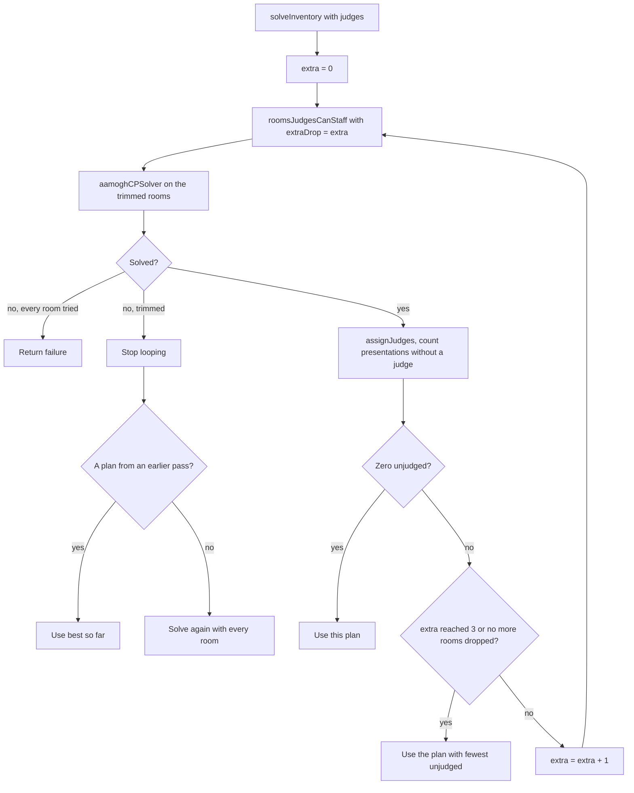
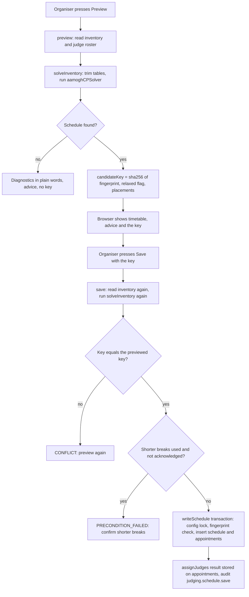

# Room-judging scheduler

The scheduler turns "these projects, these rooms, this window" into a timetable: every presentation gets a room and a start time, and then every presentation gets exactly one judge. Organisers use it from the Schedule tab of the judging admin (preview, review, save). Judges and hackers only see its output, as an itinerary.

This page is the deep dive. For the surrounding judging lifecycle see [the judging overview](./README.md); for the features that react to the schedule while it runs (advice, suggested timing, live re-balance) see [adaptive.md](./adaptive.md).

## Two stages

1. **Placement.** `aamoghCPSolver` puts each presentation in one room at one slot.
2. **Judges.** `assignJudges` gives each placed presentation one judge.

Both stages are pure functions in `packages/api/src/services/judging/schedule/`. They read no database and no clock, and they are deterministic: the same inputs give the same answer. That property is what makes the preview/save handshake below work.

A presentation (a "task") is one project presenting for one top-level challenge. A project entered in three scheduled challenges has three presentations, and the scheduler keeps them apart in time with breaks between them.

## What goes into the solver

`inputs.ts` (`selectPlan`, `planInputs`) builds the problem.

- **Rooms** count only if they are not archived, sit in a building (walking time depends on it), and serve a top-level challenge whose mode is `scheduled`. Rooms and tables are the same thing here; a table is a room whose kind says so.
- **Tasks** are the `judging_entry_challenge` rows of those scheduled challenges, one per project and challenge. A task is flagged `sponsor` when its challenge is not a general one.
- Rooms and tasks are sorted by id, so input order never changes the answer.

## The slot model

`slots.ts` cuts the judging window into equal slots. One slot is `setupMinutes + judgingMinutes + teardownMinutes`, and every appointment starts on a slot boundary.

| Field | Meaning | Router limit and default |
| --- | --- | --- |
| `setupMinutes` | Room is being set up, project arrives | 0 to 120, default 2 |
| `judgingMinutes` | Judges grade | 1 to 240, default 6 |
| `teardownMinutes` | Room is cleared | 0 to 120, default 2 |
| `sameBuildingBreakMinutes` | Rest between a project's presentations in one building | 0 to 720, default 10 |
| `crossBuildingBreakMinutes` | Rest when the project walks to another building | 0 to 720, default 20 |

The limits are in `timingInput` in `packages/api/src/routers/judging/schedule.ts`. The window must start on a whole minute, end after it starts, hold at least one slot, hold at most `MAX_SLOTS` (1440) slots, and the cross-building break cannot be shorter than the same-building one (`timingProblems`).

Each saved appointment stores three times (`appointmentTimes`):

| Time | Value |
| --- | --- |
| `startsAt` | Slot start |
| `deadlineAt` | `startsAt` + setup + judging. Judging for the presentation ends here. |
| `endsAt` | `startsAt` + a whole slot. The room is free again. |

Breaks are counted in whole slots, rounded up (`breakSlots`). Worked example with the setup 2, present 3, teardown 2 timing from the [simulations](./simulations.md) and the default breaks:

- Slot length is 2 + 3 + 2 = 7 minutes.
- An 11:00 to 14:00 window is 180 minutes, so `floor(180 / 7)` = 25 slots. The last 5 minutes are unused.
- The 10 minute same-building break is `ceil(10 / 7)` = 2 empty slots. The 20 minute cross-building break is `ceil(20 / 7)` = 3 empty slots.

## The rules

`rules.ts` (`validateSchedule`) is written apart from the solver on purpose. Every schedule the solver returns is re-checked against it, and a failure throws ("builds a schedule that breaks its own rules") instead of saving two projects into one room. The hard rules:

- Every task is placed exactly once.
- A room only hosts presentations of the challenge it serves.
- A room hosts one presentation per slot, and every slot is inside the window.
- A project's presentations are separated by at least the same-building break, or the cross-building break when the rooms are in different buildings.

If no schedule fits with the full cross-building break, the solver tries again using only the same-building break everywhere. A schedule that actually uses that allowance comes back with `relaxed: true` and a `reducedBreaks` list (project, from room, to room, empty slots left). The organiser must tick a confirmation box to save it, and the save stores `reduced_breaks_acknowledged_at`.

### The five goals

`scoreSchedule` gives a five-number score. Lower is better and numbers are compared left to right, so an earlier goal always beats a later one.

| Position | Goal | Meaning |
| --- | --- | --- |
| 0 | `sponsorFinish` | Slot where the last sponsor presentation ends |
| 1 | `sponsorIdle` | Empty slots inside sponsor rooms' busy spans, summed |
| 2 | `finish` | Slot where the last presentation of all ends |
| 3 | `buildingChanges` | Times a project changes building between presentations |
| 4 | `breaks` | Minus the empty slots between a project's presentations, so more breathing room wins ties |

Sponsor challenges finish first because their judges are other people with their own schedule, and general judging fills in around them.

## The solver: `aamoghCPSolver`

`aamogh-cp-solver.ts` is the solver the app uses. It is hand-built for this one problem, aimed at the same rules and goals as the CP-SAT model (see below) but searching differently. It works in these steps:

1. **Capacity check.** `capacityProblems` (in `solve.ts`) rejects obvious impossibilities: a challenge with more presentations than `rooms x slots`, or a project whose presentations plus breaks need more slots than the window has.
2. **Lower bounds.** Each goal gets a bound from counting alone (room capacity per challenge, each project's chain of presentations, fewest buildings a project can stay in). A goal that reaches its bound is proven optimal and the search stops working on it. The result carries `stats.proven`, and the preview shows which of the first four goals no schedule can beat.
3. **Symmetry.** Rooms of the same challenge in the same building are interchangeable, so the search places "this class at this slot", not "this room at this slot".
4. **Sweep.** Fills the grid slot by slot, sponsor presentations first, each free room taking the most constrained project.
5. **Repair.** Large-neighbourhood search aimed at one goal at a time in priority order. It frees the presentations holding a goal back and re-places them with a small exact search.
6. **Polish.** Cheap trade-and-move climbing for building changes and breaks, then exact re-seating one challenge at a time.
7. **Complete.** If the repair cannot finish a schedule, a min-conflicts search looks for any complete one, then the repair improves it.

Budgets count work, never time, and the only randomness is a generator seeded from the inputs, so a slow server gives the same answer as a fast one. After the search, the result is validated, and its own score is checked against `scoreSchedule`.

`solve.ts` also holds `solvePlan`, an older deterministic heuristic (greedy build, augmenting-path repair, hill climbing). No router code calls it; the app uses it only for `capacityProblems`, and `solve.test.ts` and `aamogh-cp-solver.test.ts` keep it as a reference.

## CP-SAT: bridge and runner

CP-SAT is Google OR-Tools' constraint solver, driven by a Python script at `packages/api/scripts/judging-schedule/cpsat.py` (with `example-problem.json` and `test_cpsat.py`). It is a fallback and an optional second opinion. Preview and save never call it, and neither does live re-balance.

| Piece | File | Job |
| --- | --- | --- |
| Bridge | `cpsat-bridge.ts` | Builds the problem file (`cpsatProblem`, `cpsatAssignmentProblem`) and reads the answer (`readCpsatSolution`, `readCpsatAssignments`). Nothing from the script is trusted: it must carry the current fingerprint and pass `validateSchedule`; its judges pass `validateJudgeAssignment`. |
| Runner | `cpsat-runner.ts` | Spawns the script on this server when `JUDGING_CPSAT_PYTHON` is set (and `JUDGING_CPSAT_SCRIPT` or the in-repo script is found). Time limit per attempt is 5 to 60 seconds, default 20 (`CPSAT_SECONDS`). Without the variable, `cpsatAvailable()` is false. |

When it is used, all from the Schedule tab (`CpsatPanel.tsx`):

- `cpsatProblem` downloads `problem.json` (with the in-app schedule as a hint when one was found), the organiser runs `CPSAT_COMMAND` on a laptop, and uploads the result with `previewCpsat` and `saveCpsat`.
- `solveCpsat` runs the script on the server when it is available, then the result is previewed and saved exactly like an upload.
- `assignJudges` (the "Assign judges" button, below) uses CP-SAT for the judge stage when the server can run it, and otherwise the in-app assigner.

`saveCpsat` goes through the same `writeSchedule` transaction as `save` and records `solver: "cp-sat"` in the audit entry.

## Assigning judges

`judges.ts` (`assignJudges`). A presentation's judge must be allowed to grade that challenge, and the judge types behave differently.

| Kind | Where they grade | Challenges |
| --- | --- | --- |
| `member` (table judge) | Any room, moving between them | Whatever the judge desk lets them see |
| `guest` | Only the room they scanned into (latest session), pinned | Only that room's challenge |

`mayGrade` enforces this. A guest with no room grades nowhere. The roster only lists guests whose session is live (not revoked, not expired).

The "Assign judges" button respects presence once judging is under way. Until the earliest open presentation is within 10 minutes of starting, every judge on the roster may be assigned. After that, absent members are dropped and only receivers (guests, and members with an open presence row or seen within `QUIET_AFTER_MS` who are not absent) keep their challenges, so the others hold what they have and gain nothing. See [adaptive](./adaptive.md#who-can-receive-work). A member on a sponsor presentation is allowed but is penalised, so sponsor judges get sponsor presentations when they exist.

Hard rules for a judge: one place per slot; enough free slots to walk between rooms (the same-building or cross-building break, none inside one room); and **at most `MAX_CONSECUTIVE` slots in a row** before at least one free slot. `MAX_CONSECUTIVE` is 4. Each judge input may carry its own `maxConsecutive`, but the roster the router builds (`rosterOf`) does not set it, so every judge uses 4.

The search is greedy plus local search, deterministic (ties break on a hash of ids):

1. **Greedy** from three orders: most-constrained presentation first; through the day in order with judges preferring to stay in their room; through the day in order without that preference. Each presentation goes to the judge that leaves the score best. The best of the three is kept.
2. **Local search** on that result: move a presentation to another judge, swap two judges' presentations, or displace a blocking presentation to another judge, up to four moves deep. Bounded at 50,000 evaluations, 100,000 displacements and 12 passes, so it stops however large the event.

The score is a vector compared left to right, lower is better:

1. Presentations with no judge.
2. Sponsor presentations graded by a table judge.
3. Presentations of the busiest judge.
4. Spread of load inside each pool of interchangeable judges.
5. Times a judge returns to a room they already graded in.
6. Negative count of day parts (quarters of the day, `DAY_PARTS` = 4) a judge grades in.

The reason for even load and spread: bias calibration in [scoring-and-results.md](./scoring-and-results.md) assumes every judge sees a random sample of projects. For scheduled challenges this assigner, not a hashed sample, decides who grades what, so even load and spread are what stand in for that assumption.

### Seat capacity

Because a member judge grades 4 slots in every 5, one judge keeps `4 / 5` of a seat filled over the day. The number of tables that can be staffed at once is

`seats = floor( sum over member judges of  max / (max + 1) )`

With the default of 4, that is `floor(members x 0.8)`. Worked example: **60 member judges give `60 x 4/5` = 48 seats.** Sixty tables running together would need 60 seats, so 12 presentations at a time would have no judge. A room with a guest judge staffs itself and does not use a member seat.

## Trimming tables to what judges can staff

`roomsJudgesCanStaff(inputs, judges, keepFirst, extraDrop)` decides which rooms to schedule in.

The judges it counts are the edition's roster: its `judging_judge` rows (`readRoster` in `routers/judging/schedule.ts`). A member row is created only when someone first opens the desk (`services/judging/principal.ts`). Approved judges who have not opened the desk therefore do not count as seats, and any active staff admin who has opened the edition's desk does. Previewing before judges have visited means no trimming.

With no member judges, every room stays. Otherwise:

1. `unstaffed` = rooms without a guest judge. `excess = unstaffed - seats + extraDrop`. If `excess <= 0`, every room stays.
2. Only general (non-sponsor) rooms are dropped; sponsor rooms never are.
3. For each general challenge, rooms are ordered by `keepFirst` (the router orders by name with numeric compare, so "Table 1" stays and the highest-numbered tables go). From the end, rooms are dropped while `excess > 0`, but never below `ceil(presentations / slots)` rooms, so the challenge can still fit.

Continuing the example with the 63 general tables from the [simulations](./simulations.md) and 60 member judges, and no sponsor rooms or guests: `excess = 63 - 48 = 15`, so the 15 highest-numbered tables are left out and 48 are scheduled. With 25 slots, the challenge needs at least `ceil(300 / 25)` = 12 tables, so the floor does not bite. Sponsor rooms without a guest judge count in `unstaffed` too, so each one raises `excess` by one, and the extra tables are still taken from the general challenge. The full-event test in the repo (63 general tables plus 8 sponsor rooms, 60 judges) therefore starts at `excess = 71 - 48 = 23`.

Filling every seat exactly can still leave a few presentations without a judge, because judges also need rests and walking time. So `solveInventory` in the router loops:

`MAX_EXTRA_DROPPED` is 3. Each pass keeps the plan with the fewest unjudged presentations and stops at the first with none. When no judges are on the roster yet, the loop does not run and every room is scheduled. The preview reports `roomsLeftOut`, and the [adaptive](./adaptive.md) advice offers to archive the left-out tables.

## Preview and save

`preview` and `save` are separate calls, but save re-solves instead of trusting the browser.

Two hashes are involved (`inputs.ts`):

- `planFingerprint` hashes the timing, the rooms (id, challenge, building) and the tasks (project, challenge, sponsor flag). It does not include judges.
- `candidateKey` hashes the fingerprint, the `relaxed` flag and every placement. The placements do depend on the judges, because the judge roster decides which tables are trimmed. A judge joining or leaving that changes the trim therefore changes the key.

Rules around the handshake:

- Both calls refuse a window that has already started (`assertWindowAhead`), and refuse if a schedule is already saved.
- The preview is a query and is never cached; each press of Preview runs the solver.
- `save` solves before opening its transaction, so no lock is held while it computes. If the new key differs from the one the browser holds, it throws `CONFLICT` ("Projects, rooms, tables, judges or timing changed since this preview..."). The UI in `SchedulePlanner.tsx` reloads the board on a conflict, and ties the reduced-breaks confirmation to one candidate key, so a new preview needs a new yes.
- `writeSchedule` takes the edition's config row lock, re-reads the inventory and recomputes the fingerprint inside the lock. If projects, rooms or tables moved meanwhile it throws `CONFLICT`.
- Appointments are inserted in chunks of 1000 (Postgres allows 65535 parameters per statement). Each gets the judge `assignJudges` chose, if that judge still exists.
- The audit action is `judging.schedule.save` (severity `warn`).

After save, judges that join later are picked up by "Assign judges" or by [live re-balance](./adaptive.md). Re-balance gives work only to receivers (a joined member counts as long as their heartbeat is fresh; see [Who can receive work](./adaptive.md#who-can-receive-work)). "Assign judges" ignores presence and uses the full roster.

## Procedures

All in `packages/api/src/routers/judging/schedule.ts`, all `isAdmin` unless noted.

| Procedure | Purpose |
| --- | --- |
| `preview` | Solve for a timing without saving. Returns appointments, summary, `proven` flags, `advice`, `candidateKey`. |
| `suggestTiming` | A starting window (see [adaptive.md](./adaptive.md)) |
| `save` | Re-solve, compare key, write |
| `drop` | Delete the saved schedule, until the first result is in |
| `cpsatProblem`, `previewCpsat`, `saveCpsat` (upload), `cpsatAvailability`, `solveCpsat` | The CP-SAT fallback |
| `get` | The live board; also triggers re-balance |
| `moveChoices`, `move` | Move one appointment to another slot or room |
| `judgeChoices`, `setAssignedJudge` | Set a judge by hand |
| `assignJudges` | Give not-yet-started presentations a judge again; CP-SAT when available |
| `setAutoRebalance` | Switch for live re-balance |
| `assignChoices`, `assign` | Book a presentation that has no appointment (a late import) |

## Where the code and tests live

| Piece | Path |
| --- | --- |
| Slots | `packages/api/src/services/judging/schedule/slots.ts` |
| Inputs, fingerprint, candidate key | `.../schedule/inputs.ts` |
| Rules and score | `.../schedule/rules.ts` |
| Solver | `.../schedule/aamogh-cp-solver.ts`, `.../schedule/solve.ts` |
| CP-SAT | `.../schedule/cpsat-bridge.ts`, `.../schedule/cpsat-runner.ts`, `packages/api/scripts/judging-schedule/cpsat.py` |
| Judges | `.../schedule/judges.ts`, `.../schedule/judge-plan.ts` |
| Board, moves | `.../schedule/board.ts`, `.../schedule/moves.ts`, `.../schedule/judge-progress.ts` |
| Router | `packages/api/src/routers/judging/schedule.ts` |
| UI | `sites/mainweb/components/admin/judging/schedule/SchedulePlanner.tsx`, `PlanAdvice.tsx`, `JudgesPanel.tsx`, `CpsatPanel.tsx` |

Each service file has a `.test.ts` beside it. Router-level tests are in `packages/api/src/.internal-tests/schedule-judges.test.ts`, including the full-event case "63 tables, 4 sponsors, 60 table judges" (420 presentations: 300 general plus 120 sponsor), which previews, saves the same schedule, and expects every one of the 420 appointments to have a judge. The Python script has `test_cpsat.py`.
