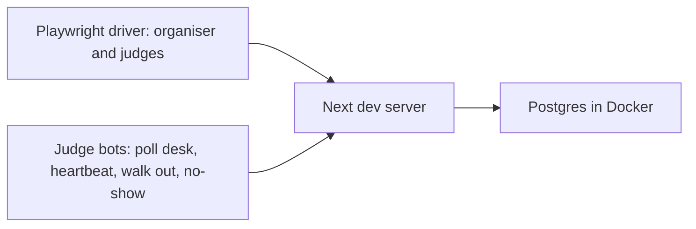

# Load simulations

The judging scheduler was tested against a full-size event with simulated organisers and judges. This page describes how those runs were done and what they found. The people who read it are organisers deciding how far to trust the scheduler, and developers changing it.

**The harness is not in this repository.** It was an out-of-repo method run on a developer machine, and the numbers below come from local runs in October 2026. You cannot reproduce them from this checkout. What the repo does contain is the unit and router tests (listed at the end), including a full-event case with the same counts (63 tables, 60 judges, 4 sponsors with 2 rooms each) but different timing: the router test uses 10-minute slots from 16:00 to 19:00 (18 slots), where the simulation used 7-minute slots from 11:00 to 14:00 (25 slots). These tests check the behaviour but not the timing under load.

## The method

- **Postgres in Docker.** A throwaway database, so a run can be wiped and repeated.
- **The Next dev server.** The real `sites/mainweb` app with the real tRPC routers, so the scheduler, desk and re-balance code are the ones that ship.
- **A Playwright driver** acting as the organiser (import projects, create rooms and tables, preview and save the schedule, watch the board) and as judges signing in and scanning into rooms.
- **Judge bots** that behave like phones in a hall: they poll the judge desk, send heartbeats, grade, walk out of a room, and sometimes do not show up at all. These exercise the presence rules behind [live re-balance](./adaptive.md#4-live-re-balance), and "no-show" is the case where a judge never joins.

## The scenario

300 projects, 63 tables, 60 judges. A presentation was 2 minutes of setup, 3 minutes of presenting and 2 minutes of teardown (a 7 minute slot), and judging ran from 11am to 2pm.

## What the runs found

### Trimming tables to what judges can staff

Before trimming, a run graded 360 presentations and 48 had no judge. The cause was the one described in [scheduler.md](./scheduler.md#seat-capacity): 63 tables running at once need 63 judges in their seats, and 60 judges can fill only about 48 at a time because each rests one slot in five. `roomsJudgesCanStaff` leaves out the tables the judges cannot staff.

After trimming, the same scenario at three sizes:

| Projects | Without a judge before | Without a judge after |
| --- | --- | --- |
| 300 | 48 | 0 |
| 500 | 129 | 0 |
| 1,200 | 360 | 120 |

At 1,200 projects, trimming cut the presentations without a judge from 360 to 120, but did not remove them.

### A fixed run

With trimming in place, one run graded 410 of 420 presentations and 0 were without a judge. The 10 misses were judge no-shows. Submit latency was p50 1.1 seconds and p95 2.2 seconds.

### Advice on real data

On real event data the preview used 44 rooms and left 27 out, and every presentation was judged. The advice (see [adaptive.md](./adaptive.md#1-setup-advice)) said:

- The four sponsor challenges decide when judging ends, and one more room each would finish about 50 minutes sooner (`sponsorRoom`).
- 27 tables would not be used with 60 judges (`unusedTables`).

`suggestTiming` proposed a 180 minute window with 30 minutes spare.

### Walkout run

Six judges left at once. The next re-balance, 5 minutes later, moved all 22 of their upcoming presentations to judges who were present, and did not churn anyone else. The final tally was 387 of 420 graded:

| Outcome | Presentations |
| --- | --- |
| Graded | 387 |
| Had a judge but no grade: judge no-shows, and presentations in progress when the six walked out | 15 |
| No judge, because 54 judges could not cover 47 tables | 18 |

There were 0 errors.

## Known follow-up

Re-balance does not yet move unjudged presentations to later free slots. It changes only who judges a presentation, never its room or time, so a presentation with no free judge at its slot stays unjudged even when a judge would be free later. The walkout run's 18 presentations without a judge were counted under the 54 judges and 47 tables above.

## What backs this in the repo

| Check | Path |
| --- | --- |
| Full event: 63 tables, 4 sponsors, 60 table judges, 420 presentations; previews, saves the same schedule, expects every appointment judged | `packages/api/src/.internal-tests/schedule-judges.test.ts` |
| Re-balance on reads, throttle, absent-judge rules | `packages/api/src/.internal-tests/schedule-judges.test.ts`, `packages/api/src/services/judging/schedule/rebalance.test.ts` |
| Solver, judge assigner, advice | `aamogh-cp-solver.test.ts`, `judges.test.ts`, `advice.test.ts` in `packages/api/src/services/judging/schedule/` |
