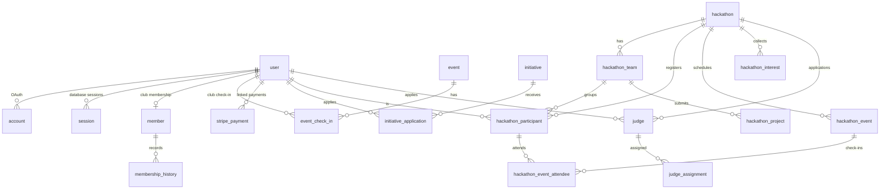
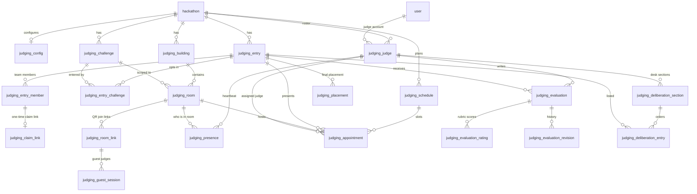

# `@query/db`

Drizzle ORM schemas, Postgres client, and membership rules. Package: `packages/db`.

## Client

`src/client.ts` builds a `pg.Pool` when `DATABASE_URL` is set:

| Setting | Default | Why |
| --- | --- | --- |
| `max` | `DB_POOL_MAX` or `20` | Cloud Run concurrency 80; 10 was too small against the Neon pooler |
| `min` | `DB_POOL_MIN` or `0` | Idle connections keep Neon from scaling to zero; raise only on a paid plan |
| `connectionTimeoutMillis` | `DB_CONNECTION_TIMEOUT_MS` or `3000` | Fail fast rather than occupy a request slot |
| `idleTimeoutMillis` | `60000` | Reuse across a burst; under Neon's 5-min scale-to-zero |
| SSL | `rejectUnauthorized: true` in production | |

If `DATABASE_URL` is missing, `db` is `null` and a warning is logged. Builds that never query still succeed.

Production: Neon serverless Postgres (`us-east-1`, next to App Hosting in us-east4), pooled endpoint (`-pooler` host). Local: `docker compose` Postgres 15 on port 5433, database `neondb`.

## Schema layout

Files in `src/schemas/`, re-exported from `schemas/index.ts`. `drizzle.config.ts` globs `./src/schemas/**/*.ts`.

| File | Tables |
| --- | --- |
| `auth.ts` | `user`, `account`, `session`, `verificationToken` |
| `members.ts` | `user_profile`, `member`, `membership_history` |
| `admins.ts` | `admin` |
| `hackathons.ts` | `hackathon`, `hackathon_team`, `hackathon_participant`, `hackathon_project`, `hackathon_interest`, `hackathon_event`, `hackathon_event_attendee`, `hackathon_check_in_flag`, `hackathon_announcement`, `hackathon_announcement_recipient` |
| `judge.ts` | `judge`, `judge_assignment` (live roster); `judging_project`, `judge_vote`, `judge_queue`, `hackathon_result` (retired, kept for past editions) |
| `judging.ts` | `judging_*`: config, entries and members, challenges, buildings, rooms and room links, judges, guest sessions, presence, schedule and appointments, rubric, evaluations, deliberation, placements, repo checks |
| `points.ts` | `hackathon_point_adjustment`, `hackathon_store_item`, `hackathon_store_purchase` |
| `retired.ts` | Enum types the retired panel judging service left in the database, declared so push does not try to drop them |
| `initiatives.ts` | `project_leader`, `initiative`, `initiative_application` |
| `events.ts` | `event`, `event_check_in` |
| `bootcamp.ts` | `bootcamp_workshop` (metadata; the ZIPs are in Cloud Storage). `bootcamp_material` is legacy and unused |
| `stripe.ts` | `stripe_payment`, `user_account_link` |
| `security.ts` | `audit_logs` (+ `security_severity` enum) |
| `settings.ts` | `system_settings` (single row, `id = 'default'`) |

Two cascade roots:

- **`user`** — accounts, sessions, admin, profile, member, judge, club events/check-ins, teams (captain), participants, Stripe `linked_user_id`
- **`hackathon`** — teams, participants, projects, weekend events, judges, assignments, judging projects, queue, results, interest, announcements

Nearly all FKs are `onDelete: "cascade"`. Deleting a user or an edition removes dependents. Exceptions are documented on the column (e.g. judging `source_project_id` is `set null` so deleting a submission does not erase votes).

### Club vs hackathon (schema)

Club tables are **not** keyed by `hackathon_id`. `member` is `unique(user_id)`. Which years someone paid is `membership_history`. Initiatives and `project_leader` are standing club appointments.

Hackathon participation does not require a membership row.

Edition statuses: `draft`, `announced`, `open`, `closed`, `in_progress`, `completed`, `cancelled`. `PRE_CURRENT_STATUSES` is `draft` and `announced` — those editions are never “current” for membership/portal resolution. `announced` is public (landing + interest) but registration is closed.

Admin roles: `super_admin`, `admin`, `moderator`, `volunteer`. Volunteers are not full staff.

Initiative statuses: `proposed` → (`declined` \| `draft`) → `open` \| `closed`. Only `open` is visible to members. Application statuses: `pending`, `accepted`, `rejected`, `withdrawn` (`withdrawn` is a state, not a delete, so the unique index still holds).

## Data model

The main tables and how they relate. Club tables are not scoped to a hackathon; everything in the hackathon and judging groups hangs off `hackathon`. The second diagram covers the `judging_*` tables.





Other tables include: `user_profile`, `club_project`, `subteam` and `subteam_application`, `member_resume`, `bootcamp_workshop` and `bootcamp_material`, `hackathon_announcement` and recipients, `hackathon_ban`, `hackathon_check_in_flag`, point adjustments, store items and purchases, `audit_logs`, `system_settings`, `admin`, `project_leader`, `user_account_link`, `verificationToken`, `judging_announcement`, `judging_rubric_item`, `judging_evaluation_draft` and `judging_evaluation_response`. The older `judging_project`, `judge_vote`, `judge_queue` and `hackathon_result` tables are retired and kept for past editions.

## Membership service

`src/services/membership.ts` is the one implementation of grant/link/current-edition. Auth sign-in, Stripe webhook, and tRPC all call it.

Notable functions:

- `resolveCurrentHackathonId` — in-progress edition, else newest non-pre-current
- `linkPaidPaymentByVerifiedEmail` — claim a paid Stripe row by verified email and upsert membership
- `setMembershipChangeHandler` — `@query/api` registers cache eviction; auth cannot import the API cache (dependency direction)

Membership is paid + unexpired. A row with a past `membership_end_date` is lapsed (`hasLapsed`), not active.

## Commands

```bash
pnpm --filter @query/db migrate:push      # drizzle-kit push to DATABASE_URL
pnpm --filter @query/db migrate:generate  # SQL into packages/db/drizzle
pnpm --filter @query/db db:check          # fail if declared columns are missing
pnpm --filter @query/db studio            # Drizzle Studio
pnpm --filter @query/db db:seed           # scripts/seed.ts
```

The repo is **push-based**: `packages/db/drizzle/meta/_journal.json` has no migration entries. App Hosting runs `drizzle-kit push --verbose < /dev/null` then `db:check`. Destructive prompts cannot be confirmed, so the push aborts rather than dropping columns; `db:check` is the real gate (push can still exit 0).

`scripts/link-payments.ts` is a one-off to attach historical paid Stripe rows to matching user emails:

```bash
pnpm --filter @query/db tsx scripts/link-payments.ts          # dry run
pnpm --filter @query/db tsx scripts/link-payments.ts --apply
```

## One-off: collapsing edition-scoped club tables

Only for a database that **already** had `project_leader` / `initiative` keyed by `hackathon_id`. **Check first:**

```sql
SELECT to_regclass('public.project_leader');
```

If that is `NULL`, skip this section — `migrate:push` creates the current shape.

If the table exists with the old unique `(user_id, hackathon_id)`, push cannot rebuild the unique index (duplicate people across editions). Run this **once, before** push. Statements are guarded; re-running is safe.

```sql
BEGIN;

WITH ranked AS (
  SELECT
    id,
    user_id,
    bool_or(is_active) OVER (PARTITION BY user_id) AS any_active,
    row_number() OVER (PARTITION BY user_id ORDER BY created_at ASC, id ASC) AS rn
  FROM project_leader
)
UPDATE project_leader AS pl
SET is_active = ranked.any_active
FROM ranked
WHERE pl.id = ranked.id
  AND ranked.rn = 1
  AND pl.is_active IS DISTINCT FROM ranked.any_active;

DELETE FROM project_leader
WHERE id IN (
  SELECT id FROM (
    SELECT
      id,
      row_number() OVER (PARTITION BY user_id ORDER BY created_at ASC, id ASC) AS rn
    FROM project_leader
  ) dupes
  WHERE rn > 1
);

ALTER TABLE project_leader
  DROP CONSTRAINT IF EXISTS unique_project_leader_per_hackathon;
DROP INDEX IF EXISTS project_leader_hackathon_id_idx;
ALTER TABLE project_leader DROP COLUMN IF EXISTS hackathon_id;

DROP INDEX IF EXISTS initiative_hackathon_id_idx;
ALTER TABLE initiative DROP COLUMN IF EXISTS hackathon_id;

ALTER TABLE project_leader
  DROP CONSTRAINT IF EXISTS unique_project_leader;
ALTER TABLE project_leader
  ADD CONSTRAINT unique_project_leader UNIQUE (user_id);

COMMIT;
```

Initiatives are not deleted. Rows that were hidden by an old edition become visible again. Archive any that should not return from the leader screen.

## Tests

`src/services/membership.test.ts` — membership date/active/lapsed rules and linking behavior.
